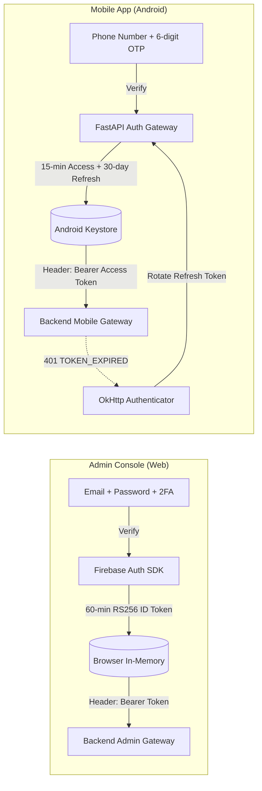

# Master Authentication & Security Specification: BOLD Monorepo Platform
**Document:** AUTH_SECURITY.md  
**Product:** BOLD Trading & Research Platform (Monorepo)  
**Parent Specifications:** `PRD.md`, `ARCHITECTURE.md`, `DATABASE.md`, `API.md`  
**Security Standard:** OWASP Top 10 & OWASP Mobile Top 10 Compliance  

---

## 1. Authentication Architecture Overview

| Subproject | Primary Auth Method | Token Storage Location | Token Lifespan & Rotation | One-Line Justification |
| :--- | :--- | :--- | :--- | :--- |
| **Admin Console** | Firebase Auth (Email/Pass + 2FA / Google OAuth) | **Browser In-Memory Only** | 60 min ID Token, auto-refreshed in background | Zero-infrastructure identity management with hardened credential security and XSS resilience. |
| **Mobile App** | Passwordless Phone SMS OTP + Biometrics | **Android Keystore (EncryptedPrefs)** | 15 min Access Token, 30-day single-use Refresh Token | Frictionless mobile-first onboarding with hardware-backed encryption against device theft. |
| **Broker Hub** | Approved In-App OAuth Flow (Read-Only) | **Encrypted Backend Vault (`api_keys_vault`)** | Provider-dependent (typically 24h Kite/Upstox token) | Securely syncs portfolio holdings without ever storing broker login credentials on client devices. |

---

## 2. JWT Design & Token Lifecycles

### 2.1 Admin Console Token Design
* **Algorithm:** RS256 (asymmetric signature).
* **Storage:** Held in browser memory only; never persisted in `localStorage` or `sessionStorage` to mitigate token theft via XSS.
* **Auto-Refresh:** Firebase client SDK automatically refreshes the ID token silently every 55 minutes.

### 2.2 Mobile Client Token Design
* **Algorithm:** RS256 (asymmetric signature).
* **Storage:** Encrypted with AES-256-GCM via `MasterKey` in the **Android Keystore System** (`EncryptedSharedPreferences`).
* **Rotation:** Single-use refresh token rotation (every `/refresh` call destroys the previous refresh token and issues a new pair).
* **Transparent Recovery:** OkHttp `Authenticator` catches `401 Unauthorized` responses and refreshes tokens without disrupting the user session.

---

## 3. Master Roles & Permissions Matrix

| Platform Action | `guest` | `mobile_user` | `operations_admin` | `compliance_lead` | `super_admin` |
| :--- | :---: | :---: | :---: | :---: | :---: |
| **View Splash & Onboarding** | ✅ Yes | ✅ Yes | ❌ N/A | ❌ N/A | ❌ N/A |
| **View Watchlists & Live Charts** | ❌ No | ✅ Yes (Free) | ✅ Yes | ✅ Yes | ✅ Yes |
| **Execute Simulated Paper Trades** | ❌ No | ✅ Yes (Free) | ❌ No | ❌ No | ❌ No |
| **Explore F&O Option Chain Desk** | ❌ No | ✅ Yes (Free) | ❌ No | ❌ No | ❌ No |
| **View Telemetry & Adapter Metrics**| ❌ No | ❌ No | ✅ Yes | ✅ Yes | ✅ Yes |
| **Rotate External Third-Party Keys** | ❌ No | ❌ No | ✅ Yes | ❌ No | ✅ Yes |
| **Trigger Platform Kill Switch** | ❌ No | ❌ No | ✅ Yes | ✅ Yes | ✅ Yes |
| **Approve Algorithmic Strategies** | ❌ No | ❌ No | ❌ No | ✅ Yes | ✅ Yes |
| **Toggle Global Feature Flags** | ❌ No | ❌ No | ✅ Yes | ❌ No | ✅ Yes |
| **Query Tamper-Evident Audit Logs**| ❌ No | ❌ No | ✅ Yes | ✅ Yes | ✅ Yes |

---

## 4. Defenses & Protective Safeguards

### 4.1 Password Hashing & Encryption
* **Admin Passwords:** Managed by Firebase Authentication utilizing modified **scrypt** with high memory/CPU cost parameters and per-user cryptographic salts.
* **Database Secrets:** External API keys in `api_keys_vault` are encrypted server-side using **AES-256-GCM** before writing to PostgreSQL. Master encryption keys are managed in cloud KMS.

### 4.2 Rate Limiting Architecture
* **Public Routes (OTP request, Quote search):** `60 requests/minute` per IP address.
* **Authenticated Routes (Paper orders, Watchlists):** `120 requests/minute` per user.
* **Sensitive Mutations (Key rotation, Kill switch):** `10 requests/minute` with strict abuse logging.

### 4.3 CORS, CSRF & XSS Defenses
* **CORS:** FastAPI enforces strict origin allowlisting: `https://bold-trading-admin.web.app` and `http://localhost:5173`.
* **CSRF:** All mutating requests require an `Authorization: Bearer <JWT>` header, rendering cookie-based CSRF attacks impossible.
* **XSS:** React inherently sanitizes string interpolations; Content Security Policy (CSP) headers in `firebase.json` restrict unauthorized script execution.

### 4.4 Absolute Paper Trading Boundary
* **Zero Real Broker Order Execution:** Simulated paper trading logic is physically separated from broker adapters.
* **Read-Only Broker Scopes:** Third-party broker connections (Zerodha, Upstox, Angel One) only ever request read scopes (`read_holdings`, `read_positions`). Order placement capabilities are physically blocked in code and network architecture.

### 4.5 Financial Precision & Decimal Safety
* **Zero Floating-Point Arithmetic:** `Float` and `Double` data types are banned for currency, order debits, fees, and P&L. All monetary values are handled using `BigDecimal` on Android and `NUMERIC(15, 2)` in PostgreSQL.

---

## 5. Subproject Security Guides

* **[`admin-panel/AUTH_SECURITY.md`](file:///d:/trading%20app/admin-panel/AUTH_SECURITY.md):** Deep-dive into Firebase Admin Auth, RBAC policies, key vault encryption, and web CSP headers.
* **[`mobile-application/AUTH_SECURITY.md`](file:///d:/trading%20app/mobile-application/AUTH_SECURITY.md):** Deep-dive into mobile SMS OTP, Android Keystore encryption, biometric app lock, network security configuration, and root detection.

---

## 6. Pre-Launch Security Checklist (OWASP Standards)

* [ ] **Zero Plain-Text Secrets:** Verified no API secrets, database passwords, or OAuth credentials exist in source code or APK assets.
* [ ] **Physical Paper Trading Isolation:** Verified paper trading engine has no network route or code link to live broker execution endpoints.
* [ ] **AES-256-GCM Secret Vault:** Verified all third-party keys stored in `api_keys_vault` are encrypted at rest with unique initialization vectors.
* [ ] **Short-Lived Access Tokens:** Admin tokens expire in 60m; Mobile tokens expire in 15m with single-use refresh token rotation.
* [ ] **Android Keystore Session Protection:** Verified mobile tokens are stored using `EncryptedSharedPreferences` backed by Android Keystore.
* [ ] **Strict Network Security Config:** Verified cleartext HTTP traffic is blocked in production release APKs (`cleartextTrafficPermitted="false"`).
* [ ] **Decimal Financial Safety:** Verified zero binary floating-point calculations for prices, fees, and virtual capital (`BigDecimal` audit passed).
* [ ] **Tamper-Evident Audit Trail:** Verified all administrative key rotations and kill switch events generate SHA-256 hashed audit events.
* [ ] **Dependency Vulnerability Scan:** Run `npm audit` and Gradle dependency check with zero high or critical CVEs.
