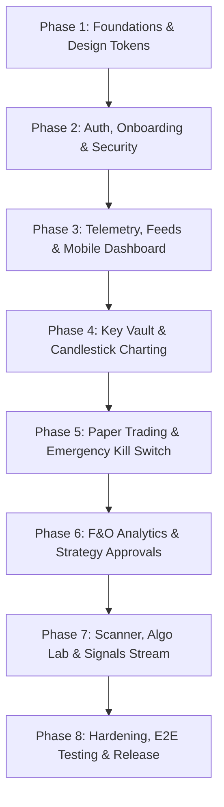

# Master Implementation Roadmap: BOLD Monorepo Platform
**Document:** PLAN.md  
**Product:** BOLD Trading & Research Platform (Monorepo)  
**Parent Specifications:** `PRD.md`, `DESIGN.md`, `ARCHITECTURE.md`, `DATABASE.md`, `API.md`  
**Execution Strategy:** Coordinated Vertical Slices ensuring both the React Admin Console and the Android Mobile Application remain runnable after every phase.

---

## Master Implementation Flowchart

---

## Phase 1: Foundations, Tooling & Design Systems
**Goal:** Establish both subprojects with their locked tech stacks, build configurations, and design systems.

* [x] **Task 1.1: Initialize Admin React 18+ & Tailwind Tokens (1.5h)**
  * **What to build:** Scaffold Vite React + TS app in `admin-panel/`; inject `#0B0F14` bg, `#121923` surface, `#38D996` bullish, `#FF657A` bearish tokens into `tailwind.config.ts`.
  * **Files touched:** `admin-panel/package.json`, `vite.config.ts`, `tailwind.config.ts`.
  * **Dependencies:** None.
  * **Verification:** `npm run dev` in `admin-panel/` starts on `http://localhost:5173` rendering token colors cleanly.

* [x] **Task 1.2: Initialize Android Multi-Module & Compose Tokens (2.0h)**
  * **What to build:** Set up Gradle module tree (`:app`, `:core:designsystem`, `:core:networking`, `:core:database`) and `BoldTheme` implementing `tnum` typography.
  * **Files touched:** `mobile-application/settings.gradle.kts`, `build.gradle.kts`, `core/designsystem/.../Theme.kt`.
  * **Dependencies:** None.
  * **Verification:** `./gradlew assembleDebug` compiles; Compose preview renders `#0B0F14` dark theme.

> **Phase 1 Definition of Done:** Both the Admin web app and the Mobile Android app compile and run locally with their respective design systems active.

---

## Phase 2: Authentication, Onboarding & Workspace Setup
**Goal:** Deliver end-to-end authentication for both platform operators and mobile users.

* [x] **Task 2.1: Admin Firebase Authentication & Shell (2.0h)**
  * **What to build:** Firebase Auth login screen, session provider, protected routes, and 240px persistent admin sidebar.
  * **Files touched:** `admin-panel/src/features/auth/*`, `src/components/layout/AdminLayout.tsx`.
  * **Dependencies:** Task 1.1.
  * **Verification:** Logging into the admin panel redirects to `/overview`; invalid credentials show an error alert.

* [x] **Task 2.2: Mobile Onboarding & OTP Auth Slice (2.0h)**
  * **What to build:** Splash screen (`S01`), mobile phone + 6-digit OTP verification (`S02`), and workspace setup (`S03`).
  * **Files touched:** `mobile-application/feature/onboarding/*`, `core/networking/AuthService.kt`.
  * **Dependencies:** Task 1.2.
  * **Verification:** User enters mobile number $\rightarrow$ submits OTP $\rightarrow$ workspace preferences persist to DataStore.

> **Phase 2 Definition of Done:** Admins can log into the web console, and mobile users can complete registration and land on the Home Dashboard.

---

## Phase 3: Telemetry, Feed Health & Mobile Dashboard Slice
**Goal:** Deliver live/mock market data pipelines, the S21 Admin Telemetry dashboard, and the Mobile Home screen.

* [x] **Task 3.1: Admin Screen S21 Telemetry Overview (2.0h)**
  * **What to build:** Metric cards (Total Users `24,860`, Feed Health `DEGRADED`, Error Rate `0.42%`) and 60-point latency area chart.
  * **Files touched:** `admin-panel/src/features/overview/*`.
  * **Dependencies:** Task 2.1.
  * **Verification:** Dashboard auto-refreshes every 15s via React Query; latency points render smoothly.

* [x] **Task 3.2: Mobile Home Dashboard & Watchlists (2.0h)**
  * **What to build:** NIFTY 50 / SENSEX index cards, virtual equity card (`₹10,42,680`), and watchlist `LazyColumn` with sparklines.
  * **Files touched:** `mobile-application/feature/dashboard/*`, `feature/watchlist/*`.
  * **Dependencies:** Task 2.2.
  * **Verification:** Real-time quote stream updates watchlist prices with sub-second response and tabular typography.

> **Phase 3 Definition of Done:** Platform health is observable in the Admin console, and mobile users can view real-time market indices and watchlists.

---

## Phase 4: Universal Key Vault & Interactive Charting
**Goal:** Deliver centralized secret management in Admin and interactive candlestick charts on Mobile.

* [x] **Task 4.1: Admin Universal Key & Secret Vault (2.0h)**
  * **What to build:** Key management table (`gemini_api`, `zerodha_kite`, `truedata_feed`), masked display (`••••••••9A12`), test ping action, and rotation modal.
  * **Files touched:** `admin-panel/src/features/keys/*`.
  * **Dependencies:** Task 2.1.
  * **Verification:** Rotating an API key updates the masked string in real time without code redeployments.

* [x] **Task 4.2: Mobile Candlestick Chart Canvas & Overlays (2.0h)**
  * **What to build:** Hardware-accelerated OHLC canvas with intervals (1m to 1D), EMA 20/50, VWAP, RSI sub-chart, and crosshair inspection.
  * **Files touched:** `mobile-application/core/charts/*`, `feature/charts/*`.
  * **Dependencies:** Task 3.2.
  * **Verification:** Pinch-to-zoom and horizontal drag navigate historical candles smoothly at 60 FPS.

> **Phase 4 Definition of Done:** Secrets can be rotated and tested via the admin panel, and mobile users can inspect any instrument on interactive charts.

---

## Phase 5: Paper Trading Terminal & Emergency Kill Switch
**Goal:** Build the complete simulated paper execution loop and emergency platform safeguards.

* [x] **Task 5.1: Mobile Paper Trading Terminal & Risk Engine (2.0h)**
  * **What to build:** Order ticket bottom sheet (Market/Limit, Stop Loss, Target, Fee calculation), 1% risk-budget checks, and simulated execution receipt.
  * **Files touched:** `mobile-application/feature/papertrading/*`.
  * **Dependencies:** Task 4.2.
  * **Verification:** Placing a simulated buy deducts virtual cash, calculates statutory fees, and logs to the virtual ledger.

* [x] **Task 5.2: Admin Emergency Kill Switch & Feature Flags (1.5h)**
  * **What to build:** Master kill switch banner requiring explicit typed confirmation to halt all simulations and signal broadcasting.
  * **Files touched:** `admin-panel/src/features/governance/*`.
  * **Dependencies:** Task 2.1.
  * **Verification:** Activating kill switch instantly reflects on mobile clients as a maintenance banner pausing order simulation.

* [x] **Task 5.3: Mobile Paper Portfolio & Trade Journal (2.0h)**
  * **What to build:** Portfolio screen with virtual balance, active positions, realized/unrealized P&L, trade journal notes, and account reset button.
  * **Files touched:** `mobile-application/feature/portfolio/*`.
  * **Dependencies:** Task 5.1.
  * **Verification:** Resetting account resets virtual cash to ₹10,00,000 and archives previous positions.

> **Phase 5 Definition of Done:** Complete paper execution loop operates with strict risk limits, while administrators can trigger platform-wide freezes at will.

---

## Phase 6: F&O Derivatives Desk & Strategy Review Queue
**Goal:** Deliver index options analytics on Mobile and quantitative strategy compliance workflows in Admin.

* [x] **Task 6.1: Mobile F&O Option Chain Desk & Payoff Canvas (2.0h)**
  * **What to build:** Strike table with live LTP, open interest, ATM highlight, Greeks ($\Delta$, $\Gamma$, $\Theta$, $\nu$), and expiry payoff curve.
  * **Files touched:** `mobile-application/feature/options/*`, `core/charts/PayoffDiagramCanvas.kt`.
  * **Dependencies:** Task 4.2.
  * **Verification:** Selecting NIFTY expiry renders strike rows with live Greeks and dynamic payoff curves.

* [x] **Task 6.2: Admin Strategy Review & Approval Queue (2.0h)**
  * **What to build:** Review table filtering strategies by risk (`Low`, `Medium`, `High`); side drawer showing rule logic and backtest metrics with Approve/Reject actions.
  * **Files touched:** `admin-panel/src/features/strategies/*`.
  * **Dependencies:** Task 2.1.
  * **Verification:** Approving a strategy changes status to `Approved` and schedules it for broadcast to the mobile signals feed.

> **Phase 6 Definition of Done:** Derivatives traders can evaluate option Greeks and payoff graphs, and compliance officers can review and sign off on quant strategies.

---

## Phase 7: Market Scanner, Algo Lab & Signals Stream
**Goal:** Deliver technical scanner presets, visual strategy building with backtesting, and real-time signal broadcasting.

* [x] **Task 7.1: Mobile Market Scanner Presets (1.5h)**
  * **What to build:** Scanner filter chips (`Breakout`, `Volume Spike`, `VWAP Reclaim`); results list displaying trigger criteria and match timestamps.
  * **Files touched:** `mobile-application/feature/scanner/*`.
  * **Dependencies:** Task 3.2.
  * **Verification:** Tapping a preset displays matched stocks meeting technical criteria.

* [x] **Task 7.2: Mobile Strategy Builder & Backtest Engine (2.0h)**
  * **What to build:** Condition builder blocks (Entry, Exit, Risk); historical backtest runner plotting equity curves and drawdown metrics.
  * **Files touched:** `mobile-application/feature/algo/*`, `feature/backtest/*`.
  * **Dependencies:** Task 7.1.
  * **Verification:** Validating rules outputs clean AST JSON; running backtest renders historical performance metrics.

* [x] **Task 7.3: Mobile Signals Feed with Direct Simulation (1.5h)**
  * **What to build:** Signal cards with entry zones, stop loss, and targets; "Simulate trade" CTA pre-populating the paper order ticket.
  * **Files touched:** `mobile-application/feature/signals/*`.
  * **Dependencies:** Tasks 7.2, 5.1.
  * **Verification:** Tapping "Simulate trade" opens the order preview sheet with signal parameters pre-filled.

> **Phase 7 Definition of Done:** Users can scan the market, construct automated strategies, run backtests, and trade approved signals in the paper terminal.

---

## Phase 8: Hardening, E2E Audits & Production Release
**Goal:** Polish offline capabilities, verify zero live order execution boundaries, conduct accessibility audits, and release both builds.

* [x] **Task 8.1: Mobile Room Database Offline Caching & Stale Watermarks (2.0h)**
  * **What to build:** Cache watchlists and candles in Room SQLite; render stale data watermarks when offline.
  * **Files touched:** `mobile-application/core/database/*`.
  * **Dependencies:** Phases 1–7.
  * **Verification:** Offline launch displays cached instruments without network exceptions.

* [x] **Task 8.2: Accessibility & Financial Arithmetic Audits (1.5h)**
  * **What to build:** Audit TalkBack screen reader labels and WCAG 2.1 AA contrast; verify zero floating-point arithmetic (`BigDecimal` everywhere).
  * **Files touched:** Both subprojects.
  * **Dependencies:** Phases 1–7.
  * **Verification:** 100% test pass on monetary calculations to the exact paise; keyboard navigation works across all admin views.

* [x] **Task 8.3: Deploy Admin to Firebase & Assemble Release APK (1.5h)**
  * **What to build:** Deploy web console to Firebase Hosting (`firebase deploy --only hosting`); compile signed release APK for Android (`./gradlew assembleRelease`).
  * **Files touched:** `admin-panel/firebase.json`, `mobile-application/app/build.gradle.kts`.
  * **Dependencies:** Tasks 8.1, 8.2.
  * **Verification:** Admin console is live on HTTPS with < 200 KB gzipped bundle; Android release APK runs smoothly with 60 FPS rendering.

> **Phase 8 Definition of Done:** Production release complete. Admin Console is live on Firebase Hosting; Android release build is packaged, fully tested, and verified for distribution.
