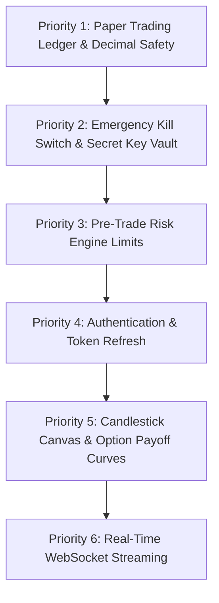

# Master Testing Strategy & Quality Assurance Plan: BOLD Monorepo Platform
**Document:** TESTING.md  
**Product:** BOLD Trading & Research Platform (Monorepo)  
**Parent Specifications:** `PRD.md`, `FEATURES.md`, `API.md`, `AUTH_SECURITY.md`  
**Execution Rule:** Tests are implemented and verified **one feature at a time**. Tests for a feature must pass 100% before starting the next feature.

---

## 1. Master Testing Tools & Architecture

| Scope | Subproject | Testing Framework | Primary Purpose |
| :--- | :--- | :--- | :--- |
| **Unit & Component** | `admin-panel` | **Vitest + React Testing Library** | Lightning-fast DOM component rendering and logic tests. |
| **Network Mocking** | `admin-panel` | **Mock Service Worker (MSW v2)** | Network-level interception of REST API endpoints. |
| **End-to-End (E2E)** | `admin-panel` | **Playwright** | Full browser automation of admin login, key rotation, and kill switches. |
| **Unit & Coroutines**| `mobile-application`| **JUnit 5 + MockK + Turbine** | Idiomatic Kotlin unit testing and `StateFlow` emission validation. |
| **Integration & Cache**| `mobile-application`| **Robolectric + OkHttp MockWebServer** | Local JVM testing of Room SQLite database and network serialization. |
| **UI Automation** | `mobile-application`| **Compose Testing Framework** | Verification of 60 FPS Compose rendering, 48dp touch targets, and semantics. |

---

## 2. Test Priorities Across Layers (Critical Paths First)



1. **Priority 1 (Financial Arithmetic & Ledger Integrity):**
   * Double-entry paper trading ledger reconciliation.
   * Decimal safety: Zero floating-point arithmetic (`BigDecimal` audit).
   * Physical isolation: Absolute separation between paper trading and live broker gateways.
2. **Priority 2 (Platform Governance & Secret Security):**
   * Emergency Kill Switch activation barrier (typed confirmation requirement).
   * AES-256-GCM secret key encryption and masking in `api_keys_vault`.
3. **Priority 3 (Risk Controls):**
   * Pre-trade stop-loss enforcement, 1% per-trade budget, and 2% daily loss limit.

---

## 3. Master Feature Test Matrix

| Feature | Subproject | Primary Test Suite | Critical Test Scenario |
| :--- | :--- | :--- | :--- |
| **A1: Admin Auth** | `admin-panel` | `LoginForm.test.tsx` | Verifies JWT claims and redirects unauthenticated access to `/login`. |
| **A2: S21 Telemetry** | `admin-panel` | `OverviewGrid.test.tsx` | Verifies 15s auto-polling and feed degradation alert on latency > 500ms. |
| **A3: Key Vault** | `admin-panel` | `KeyListTable.test.tsx` | Verifies secrets are masked (`••••••••abcd`) and upstream test pings work. |
| **A4: Kill Switch** | `admin-panel` | `KillSwitchModal.test.tsx` | Verifies modal blocks submission until user types `"CONFIRM FREEZE"`. |
| **A5: Strategy Review**| `admin-panel` | `StrategyQueueTable.test.tsx`| Verifies risk filtering and mandatory notes on strategy rejection. |
| **A6: Audit Trail** | `admin-panel` | `AuditLogTable.test.tsx` | Verifies SHA-256 event hash display and search filtering by IP/email. |
| **M1: Mobile Auth** | `mobile-application` | `AuthViewModelTest.kt` | Verifies OTP countdown timer and Keystore encrypted session storage. |
| **M2: Dashboard** | `mobile-application` | `DashboardViewModelTest.kt`| Verifies real-time price updates via WebSocket without layout shifts. |
| **M3: Charts** | `mobile-application` | `CandlestickCanvasTest.kt` | Verifies 100-candle rendering, zoom/pan gestures, and EMA/VWAP overlays. |
| **M4: Paper Terminal**| `mobile-application` | `PaperTerminalViewModelTest.kt`| Verifies order execution, fee deduction, and 2% daily loss limit rejection. |
| **M5: Portfolio** | `mobile-application` | `PortfolioViewModelTest.kt`| Verifies live P&L mark and ₹10,00,000 account balance reset. |
| **M6: F&O Chain** | `mobile-application` | `OptionChainViewModelTest.kt`| Verifies ATM strike highlight, Greeks calculation, and payoff canvas curve. |
| **M7: Scanner** | `mobile-application` | `ScannerViewModelTest.kt` | Verifies VWAP reclaim filter match checkmarks and direct trade CTA handoff. |

---

## 4. Test Data & Mocking Architecture

1. **Admin Panel Mocking (MSW):**
   * Mock Service Worker intercepts `GET /v1/admin/*` and `POST /v1/admin/*` network calls, simulating 200 OK, 422 Unprocessable, and 503 Stale Feed scenarios.
2. **Mobile Application Mocking:**
   * **OkHttp MockWebServer:** Simulates the market WebSocket tick stream and REST responses.
   * **In-Memory Room Database:** Executes SQLite cache tests in an isolated, volatile database destroyed after each test class.
   * **Fake Repositories:** Unit tests isolate ViewModels from network latency using deterministic fake repositories.

---

## 5. Coverage Thresholds & Commands

### 5.1 Coverage Mandates
* **Financial Calculations, Ledger & Risk Engine:** **100% Coverage** (Zero tolerance for rounding or fee calculation errors).
* **Application Core Logic (ViewModels, Hooks, Repositories):** Minimum **85% Coverage**.
* **UI Components & Composables:** Minimum **75% Coverage**.

### 5.2 Execution Commands

#### Run Admin Panel Tests:
```bash
cd admin-panel
npm test                        # Run Vitest test suite
npx vitest run --coverage       # Generate coverage report
npx playwright test             # Run Playwright E2E browser tests
```

#### Run Mobile Application Tests:
```bash
cd mobile-application
./gradlew test                  # Run all unit tests
./gradlew jacocoTestReport      # Generate JaCoCo coverage report
./gradlew connectedAndroidTest  # Run Compose UI tests on emulator
```

---

## 6. Pre-Release Master QA Checklist

* [ ] **Physical Paper Trading Isolation:** Verified that simulated orders never transmit requests to live broker gateways.
* [ ] **Exact Financial Reconciliations:** Verified virtual capital, debits, and P&L reconcile to the exact paise (`0.01`).
* [ ] **Emergency Kill Switch:** Verified engaging the kill switch halts simulated order submission in < 500ms.
* [ ] **Secret Zero-Leakage Audit:** Verified no unmasked secrets exist in DOM, source code, or Logcat streams.
* [ ] **Offline Stale Watermarks:** Verified app renders `● ILLUSTRATIVE / Live quote not connected` when network is severed.
* [ ] **Accessibility Standards:** Verified WCAG 2.1 AA focus rings in web console and Android TalkBack screen reader labels.
* [ ] **Memory Leak Inspection:** Verified 15-minute continuous market streaming in Android Studio Profiler exhibits zero memory leaks.

---

## 7. Subproject Testing Guides

* **[`admin-panel/TESTING.md`](file:///d:/trading%20app/admin-panel/TESTING.md):** Detailed test cases and MSW mock handlers for Features A1 to A6.
* **[`mobile-application/TESTING.md`](file:///d:/trading%20app/mobile-application/TESTING.md):** Detailed test cases, Turbine Flow assertions, and in-memory Room setups for Features M1 to M7.
