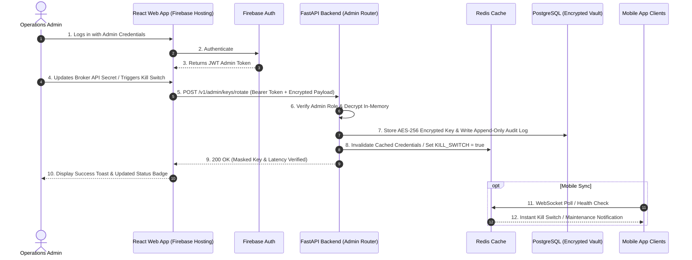

# System Architecture Specification: BOLD Admin & Compliance Console
**Document:** ARCHITECTURE.md  
**Product:** BOLD Admin & Compliance Console (Control Room)  
**Target:** Web / SPA  
**Source of Truth:** [`admin-panel/PRD.md`](file:///d:/trading%20app/admin-panel/PRD.md) and [`admin-panel/DESIGN.md`](file:///d:/trading%20app/admin-panel/DESIGN.md)  

---

## 1. Recommended Tech Stack

| Layer | Technology | One-Line Justification |
| :--- | :--- | :--- |
| **Frontend Framework** | **React 18+ (TypeScript)** | Industry standard for complex dashboards with the largest ecosystem and strong typing. |
| **Build Tool** | **Vite** | Instant Hot Module Replacement (HMR) and optimized, lightweight production bundling. |
| **Styling & Components**| **Tailwind CSS + Shadcn UI (Radix)** | Token-accurate styling adhering strictly to `DESIGN.md` without heavy runtime CSS overhead. |
| **State & Server Cache**| **TanStack Query (React Query v5)** | Effortless caching, background refetching of telemetry, and optimistic updates for settings. |
| **Global Client State** | **Zustand** | Minimalist (<1 KB), boilerplate-free client state for modals, active filters, and sidebar states. |
| **Authentication** | **Firebase Auth** | Free, zero-maintenance admin authentication with built-in token management and security. |
| **Backend API** | **FastAPI (Python)** | High-throughput asynchronous REST API shared with the BOLD platform for encrypted key operations. |
| **Database & Cache** | **PostgreSQL & Redis** | ACID-compliant relational storage for encrypted keys and audit trails, with Redis for sub-millisecond kill switches. |
| **Hosting** | **Firebase Hosting (Free Spark Tier)** | Globally distributed CDN, free custom SSL, and zero monthly hosting cost. |

---

## 2. Complete Folder and File Structure

```text
admin-panel/
├── .env.example                     # Sample environment variable template
├── .gitignore
├── firebase.json                    # Firebase Hosting rewrite and header rules
├── index.html                       # Application HTML entry point
├── package.json
├── postcss.config.js
├── tailwind.config.ts               # Custom tokens from DESIGN.md (#0B0F14, #121923, #38D996)
├── tsconfig.json
├── vite.config.ts                   # Path aliases and build optimizations
│
├── public/
│   ├── favicon.ico
│   └── robots.txt                   # Disallow web indexing for admin portal
│
└── src/
    ├── app/                         # App routing and provider wrappers
    │   ├── App.tsx                  # Root component with Theme and Query providers
    │   ├── router.tsx               # React Router v6 definitions with ProtectedRoute guards
    │   └── providers.tsx            # Composition of QueryClientProvider, AuthProvider, ToastProvider
    │
    ├── assets/                      # Static icons, logos, illustrations
    │   └── icons/
    │
    ├── components/                  # Reusable UI component library (DESIGN.md strict)
    │   ├── ui/                      # Base primitives (Shadcn/Radix wrappers)
    │   │   ├── button.tsx           # Primary, Destructive, Outline, Ghost
    │   │   ├── input.tsx            # Form inputs and masked secret fields
    │   │   ├── badge.tsx            # Status pills (Active, Degraded, Expired)
    │   │   ├── card.tsx             # Surface containers with #253140 borders
    │   │   ├── dialog.tsx           # Modals for Key Rotation & Confirmation
    │   │   ├── dropdown-menu.tsx    # Context action menus
    │   │   ├── table.tsx            # Data tables with tabular font support
    │   │   └── toast.tsx            # Notifications for copy, save, and error events
    │   ├── layout/                  # Page scaffolding
    │   │   ├── AdminLayout.tsx      # Sidebar + Topbar + Content area container
    │   │   ├── Sidebar.tsx          # 240px navigation rail with active route highlights
    │   │   └── Header.tsx           # Environment pill (SANDBOX/LIVE), clock, admin profile
    │   └── feedback/                # Feedback & guard components
    │       ├── ErrorBoundary.tsx    # Catches React render crashes
    │       ├── KillSwitchModal.tsx  # Double-confirmation modal for system freeze
    │       └── LoadingSkeleton.tsx  # Skeleton placeholders for tables and metrics
    │
    ├── features/                    # Feature modules mapped to PRD screens
    │   ├── auth/                    # Login and session handling
    │   │   ├── components/LoginForm.tsx
    │   │   ├── hooks/useAuth.ts
    │   │   └── services/authService.ts
    │   ├── overview/                # Screen S21: Telemetry & Platform Overview
    │   │   ├── components/MetricCard.tsx
    │   │   ├── components/FeedLatencyChart.tsx
    │   │   └── hooks/useTelemetry.ts
    │   ├── keys/                    # Universal Key & Secret Manager Hub
    │   │   ├── components/KeyListTable.tsx
    │   │   ├── components/RotateKeyDialog.tsx
    │   │   ├── components/TestPingButton.tsx
    │   │   └── hooks/useKeyManager.ts
    │   ├── strategies/              # Strategy Review & Approval Queue
    │   │   ├── components/StrategyQueueTable.tsx
    │   │   ├── components/StrategyDetailDrawer.tsx
    │   │   └── hooks/useStrategyReview.ts
    │   ├── feed-health/             # Broker Adapters & Feed Health
    │   │   ├── components/AdapterGrid.tsx
    │   │   └── hooks/useAdapterStatus.ts
    │   ├── governance/              # Feature Flags & Emergency Kill Switch
    │   │   ├── components/KillSwitchBanner.tsx
    │   │   ├── components/FeatureFlagsList.tsx
    │   │   └── hooks/useGovernance.ts
    │   └── audit/                   # Tamper-Evident Audit Trail
    │       ├── components/AuditLogTable.tsx
    │       └── hooks/useAuditLogs.ts
    │
    ├── lib/                         # Shared utilities and SDK configurations
    │   ├── api.ts                   # Axios client with bearer token injection & interceptors
    │   ├── firebase.ts              # Firebase client SDK initialization
    │   ├── formatters.ts            # Tabular price, latency (ms), and IST date formatters
    │   └── validations.ts           # Zod schemas for key rotation and form inputs
    │
    ├── stores/                      # Client state
    │   └── useUIStore.ts            # Sidebar open/closed, active modals, theme state
    │
    └── types/                       # TypeScript models
        ├── auth.ts
        ├── keys.ts                  # Key metadata, status, provider enum
        ├── telemetry.ts             # Latency samples, error rate, user metrics
        ├── strategy.ts              # Strategy rule AST, backtest metrics
        └── audit.ts                 # Audit event schema with hash IDs
```

---

## 3. Data Flow Architecture



### Flow Breakdown
1. **Authentication Flow:** The Admin authenticates via Firebase Auth. The ID token containing custom admin claims is sent with every HTTPS request via an Axios request interceptor (`Authorization: Bearer <token>`).
2. **Key Update & Encryption Flow:**
   * Keys are submitted over TLS (HTTPS).
   * The backend validates the admin claim, encrypts the secret using AES-256-GCM before writing to PostgreSQL, and updates the in-memory/Redis cache.
   * Plain-text keys are **never stored** and **never returned** back to the browser; only masked strings (`••••••••9A12`) are returned.
3. **Emergency Kill Switch Flow:**
   * Toggling the kill switch writes directly to Redis key `PLATFORM:KILL_SWITCH = true` within `< 10ms`.
   * Both the market data ingestion workers and mobile WebSocket channels immediately halt signal broadcasting.

---

## 4. State Management Approach & Error-Handling Strategy

### 4.1 State Management Approach
* **Server State (TanStack Query):**
  * All remote data (telemetry, feed status, key lists, audit logs) is managed by TanStack Query.
  * **Telemetry Polling:** Live feed health and error rates poll every `15 seconds` (`refetchInterval: 15000`).
  * **Optimistic Updates:** Toggling feature flags applies immediately in the UI; if the network call fails, the UI rolls back cleanly with a toast notification.
* **Client State (Zustand):**
  * Lightweight global store for ephemeral UI state: sidebar collapse state, selected key filter, and active dialog states.

### 4.2 Error-Handling Strategy
1. **Global React Error Boundary:** Wraps the entire layout to catch unexpected JavaScript crashes, rendering a clean fallback view with a *"Reload Control Room"* button rather than a white screen.
2. **Axios Centralized Interceptor:**
   * `401 Unauthorized`: Automatically refreshes the Firebase token; if invalid, redirects to `/login`.
   * `403 Forbidden`: Displays an *"Insufficient Permissions"* banner (e.g., if an operator tries to rotate a key without admin rights).
   * `500+ Server Errors`: Surfaces a persistent error toast with the corresponding backend `request_id` for quick log tracing.
3. **Zod Form Validation:** All key input fields and rule forms are validated client-side with Zod schemas prior to dispatching network payloads.

---

## 5. Naming Conventions, Code Style & Environment Variables

### 5.1 Naming Conventions & Code Style
* **Files & Directories:**
  * Components: `PascalCase.tsx` (e.g., `MetricCard.tsx`, `KeyListTable.tsx`).
  * Hooks: `camelCase.ts` prefixed with `use` (e.g., `useKeyManager.ts`).
  * Utilities & Types: `camelCase.ts` (e.g., `formatters.ts`, `telemetry.ts`).
* **Variables & Functions:** `camelCase` for logic functions; `UPPER_SNAKE_CASE` for global configuration constants.
* **TypeScript Discipline:** Strict mode enabled (`"strict": true`). No `any` types; all API responses must have corresponding TypeScript interfaces.
* **Styling Rule:** Always use Tailwind utility classes referencing tokens configured in `tailwind.config.ts` (`bg-surface-card`, `text-primary-bullish`, `border-border-subtle`).

### 5.2 Environment Variables List (`.env`)

```bash
# Firebase Client SDK Config
VITE_FIREBASE_API_KEY="AIzaSyA..."
VITE_FIREBASE_AUTH_DOMAIN="bold-trading-admin.firebaseapp.com"
VITE_FIREBASE_PROJECT_ID="bold-trading-admin"
VITE_FIREBASE_STORAGE_BUCKET="bold-trading-admin.appspot.com"
VITE_FIREBASE_MESSAGING_SENDER_ID="1234567890"
VITE_FIREBASE_APP_ID="1:1234567890:web:abcdef"

# BOLD Backend Base URL
VITE_API_BASE_URL="https://api.boldtrading.internal/v1"

# Environment Identifier
VITE_APP_ENV="production" # production | staging | sandbox
```

---

## 6. Scalability, Performance & Hosting Notes (Free Tier Maximization)

1. **Zero-Cost Firebase Free Tier Optimization:**
   * The SPA bundle is compiled as static HTML/JS/CSS assets. Firebase Hosting provides **10 GB of storage and 360 MB/day transfer** for free.
   * Static assets are cache-busted with unique hash chunks and served via Google's global CDN with `Cache-Control: public, max-age=31536000, immutable`.
2. **Bundle Size Budgets:**
   * Total gzipped JavaScript bundle size is constrained to **< 200 KB** using Vite's tree-shaking and dynamic code-splitting (`React.lazy()` for `/audit` and `/strategies` routes).
   * Direct imports are used for icon libraries (Lucide React) to avoid importing unused SVG symbols.
3. **Efficient Telemetry Ingestion:**
   * Latency area charts use downsampled timeseries points (maximum 60 points for the last hour) to prevent browser DOM lag.
