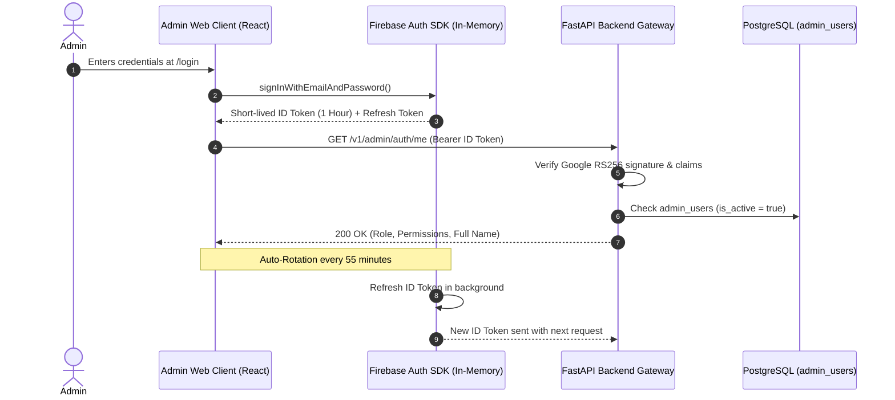

# Authentication & Security Architecture: Admin & Compliance Console
**Document:** AUTH_SECURITY.md  
**Product:** BOLD Control Room (Admin Panel)  
**Target:** React 18+ (Vite, TypeScript, Tailwind CSS, Firebase Hosting)  
**Source of Truth:** [`admin-panel/PRD.md`](file:///d:/trading%20app/admin-panel/PRD.md), [`admin-panel/ARCHITECTURE.md`](file:///d:/trading%20app/admin-panel/ARCHITECTURE.md), [`admin-panel/DATABASE.md`](file:///d:/trading%20app/admin-panel/DATABASE.md), and [`admin-panel/API.md`](file:///d:/trading%20app/admin-panel/API.md)  

---

## 1. Authentication Methods & User Flows

| Auth Method | Technology / Provider | One-Line Justification |
| :--- | :--- | :--- |
| **Email & Password + 2FA** | **Firebase Authentication** | Battle-tested, zero-infrastructure identity management with out-of-the-box credential security. |
| **Corporate Google OAuth** | **Firebase OAuth (Domain-Gated)** | Restricts single-click sign-in strictly to authorized company domains (`@boldtrading.internal`). |

### 1.1 Complete Admin Login Flow
1. **Initiation:** Admin navigates to `/login` and enters company email and password.
2. **Client Validation:** Zod validates email format (`@boldtrading.internal`) and minimum 8-character password length.
3. **Upstream Verification:** Firebase SDK transmits credentials over TLS 1.3 to Firebase Auth.
4. **Token & Claims Issuance:** Firebase returns a signed JWT containing custom claims (`role: "operations_admin"`).
5. **Backend Verification:** Admin app calls `GET /v1/admin/auth/me`. The FastAPI backend validates the JWT signature against Google public keys and verifies the user exists in PostgreSQL table `admin_users`.
6. **Session Storage:** Token is held in browser memory; Axios attaches `Authorization: Bearer <token>` to all requests.

### 1.2 Logout & Session Revocation Flow
1. **User Action:** Admin clicks **Log Out** in the top-right header menu.
2. **Client Cleanup:** Firebase `auth.signOut()` executes, clearing all in-memory tokens.
3. **Server Invalidation:** App fires `POST /v1/admin/auth/logout` to log session termination in `audit_events`.
4. **Redirect:** User is redirected to `/login`; browser history state is cleared.

### 1.3 Password Reset Flow
1. Admin clicks *"Forgot Password"* on the `/login` screen.
2. Enters verified corporate email $\rightarrow$ Clicks *"Send Reset Link"*.
3. Firebase Auth generates an OOB (out-of-band) cryptographically secure, time-limited (15-minute) reset email.
4. Admin opens email, navigates to the secure Firebase reset portal, updates password, and is forced to log in again.

---

## 2. JWT Design: Tokens, Expiry, Storage & Rotation



* **Access Token (ID Token):**
  * **Algorithm:** RS256 (asymmetric cryptographic signature).
  * **Lifespan:** Exactly `60 minutes`.
  * **Storage Location:** Browser **In-Memory only** (never written to `localStorage` or `sessionStorage` to mitigate XSS exfiltration).
* **Refresh Token:**
  * **Management:** Maintained exclusively by the official Firebase Auth client SDK inside secure browser storage.
  * **Rotation:** Background silent refresh executes every `55 minutes` before token expiration.
* **Revocation Strategy:**
  * Setting `is_active = false` in `admin_users` immediately invalidates access on the backend gateway regardless of JWT expiry.

---

## 3. Roles & Permissions Matrix (RBAC)

| Resource / Action | `super_admin` | `operations_admin` | `compliance_lead` | `quant_lead` | Justification |
| :--- | :---: | :---: | :---: | :---: | :--- |
| **View Telemetry (S21)** | ✅ Full | ✅ Full | ✅ Full | ✅ Read-only | Operational visibility is shared across technical teams. |
| **Rotate External Keys** | ✅ Full | ✅ Full | ❌ Blocked | ❌ Blocked | Only infrastructure operations staff may touch secrets. |
| **Test Ping API Keys** | ✅ Full | ✅ Full | ❌ Blocked | ❌ Blocked | Prevents unauthorized credential probing. |
| **Trigger Kill Switch** | ✅ Full | ✅ Full | ✅ Full | ❌ Blocked | Emergency stop requires immediate executive & ops access. |
| **Approve Strategies** | ✅ Full | ❌ Blocked | ✅ Full | ❌ Blocked | Compliance officers hold sole regulatory sign-off power. |
| **Toggle Feature Flags** | ✅ Full | ✅ Full | ❌ Blocked | ❌ Blocked | Product flags are governed by DevOps and super admins. |
| **Query Audit Trail** | ✅ Full | ✅ Full | ✅ Full | ❌ Blocked | Audit records are inspectable by operations and compliance. |
| **Manage Admin Users** | ✅ Full | ❌ Blocked | ❌ Blocked | ❌ Blocked | User administration is strictly reserved for super admins. |

---

## 4. Platform Security Safeguards

### 4.1 Password Hashing & Encryption
* **Hashing Algorithm:** Managed by Firebase Auth using customized **scrypt** with unique per-user salts and high CPU/memory cost parameters.
* **Zero Plain-Text Policy:** Plain-text passwords never touch application servers or application logs.

### 4.2 Rate Limiting
* **General Admin Routes:** `120 requests/minute` per IP address.
* **Sensitive Endpoints (`/rotate`, `/kill-switch`):** `10 requests/minute` per user account to prevent brute-force attacks or race conditions.
* **Failed Login Limiting:** Firebase Auth automatically throttles and temporarily locks IP addresses after 5 consecutive failed attempts.

### 4.3 CORS (Cross-Origin Resource Sharing)
* The FastAPI backend configures an explicit allowlist:
  ```python
  origins = [
      "https://bold-trading-admin.web.app",
      "https://bold-trading-admin.firebaseapp.com",
      "http://localhost:5173" # Development only
  ]
  ```
* Wildcards (`*`) and unauthenticated origins are strictly rejected.

### 4.4 CSRF Protection
* Because the Admin Console utilizes **Bearer Token authentication** transmitted via the HTTP `Authorization` header (rather than browser cookies), cross-site request forgery attacks are fundamentally mitigated.

### 4.5 XSS (Cross-Site Scripting) Protection
* **Automatic Output Escaping:** React JSX inherently encodes variables before rendering to DOM.
* **Content Security Policy (CSP):** Enforced via `firebase.json` response headers:
  ```http
  Content-Security-Policy: default-src 'self'; script-src 'self'; connect-src 'self' https://api.boldtrading.internal https://identitytoolkit.googleapis.com; style-src 'self' 'unsafe-inline'; img-src 'self' data:; font-src 'self';
  ```

---

## 5. Input Validation & Sanitization

1. **Client-Side Validation (Zod):** Every form field, secret string, and query parameter is parsed against strict Zod schemas before network dispatch.
2. **Server-Side Validation (Pydantic v2):** All API request bodies are validated against strict Pydantic schemas. Unrecognized payload fields trigger `422 Unprocessable Entity` and are discarded.
3. **SQL Injection Elimination:** Direct raw SQL concatenation is strictly prohibited; all database interactions utilize parameterized queries via SQLAlchemy ORM / AsyncPG.

---

## 6. Secrets Management & Environment Variables

* **Universal Key Vault (`api_keys_vault`):**
  * All external secrets (Gemini AI, Zerodha, Upstox, FCM) are encrypted server-side using **AES-256-GCM** with a 96-bit initialization vector (`IV`) and authentication tag before writing to PostgreSQL.
  * Master encryption key is stored in cloud Key Management Service (KMS), never in repository source files.
* **Frontend Secret Hygiene:**
  * The React frontend `.env` contains **only public identifiers** (`VITE_FIREBASE_API_KEY`, `VITE_FIREBASE_PROJECT_ID`).
  * Backend API secrets, database passwords, and KMS keys are **never** prefixed with `VITE_` and are completely inaccessible to client bundles.

---

## 7. Pre-Launch Security Checklist (OWASP Top 10)

* [ ] **A01: Broken Access Control:** Verified that non-admin tokens cannot access `/v1/admin/*` routes.
* [ ] **A02: Cryptographic Failures:** Verified all keys in `api_keys_vault` are encrypted with AES-256-GCM; verified all traffic is TLS 1.3 only.
* [ ] **A03: Injection:** Verified parameterized SQL queries across all endpoints; verified Zod input sanitization.
* [ ] **A04: Insecure Design:** Verified the Master Kill Switch has a typed confirmation barrier to prevent accidental actuation.
* [ ] **A05: Security Misconfiguration:** Verified CSP, HSTS, `X-Content-Type-Options: nosniff`, and `X-Frame-Options: DENY` headers in `firebase.json`.
* [ ] **A06: Vulnerable Dependencies:** Executed `npm audit` with 0 high or critical vulnerabilities.
* [ ] **A07: Identification & Auth Failures:** Verified 60-minute JWT token expiry and automatic session timeout after 30 minutes of inactivity.
* [ ] **A08: Software & Data Integrity:** Verified SHA-256 HMAC integrity hashes on all rows in `audit_events`.
* [ ] **A09: Logging & Monitoring:** Verified all key rotations and kill switch events are recorded with actor email, timestamp, and IP address.
* [ ] **A10: SSRF:** Verified third-party test ping endpoints strictly validate target URLs against a static internal provider whitelist.
