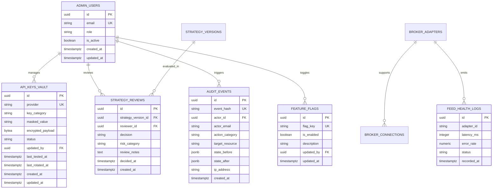

# Database Architecture & Schema Specification: Admin & Compliance Console
**Document:** DATABASE.md  
**Product:** BOLD Admin & Compliance Console (Control Room)  
**Database Engine:** PostgreSQL 16+ (with pgcrypto for AES-256 encryption & TimescaleDB/partitioning)  
**Source of Truth:** [`admin-panel/PRD.md`](file:///d:/trading%20app/admin-panel/PRD.md), [`admin-panel/ARCHITECTURE.md`](file:///d:/trading%20app/admin-panel/ARCHITECTURE.md), and BOLD Brief Section 9 & Screen S21  

---

## 1. Overview & Architectural Principles

The Admin Console manages platform governance, universal API keys and secrets, system-wide kill switches, strategy approval workflows, and tamper-evident audit trails.

### Core Database Rules:
1. **Zero Raw Secret Exposure:** API secrets and broker OAuth tokens are encrypted at rest using AES-256-GCM (`pgcrypto` / backend KMS). Only masked strings (e.g., `••••••••9A12`) are stored in queryable columns.
2. **Immutable Audit Trail:** All administrative, financial, and permission mutations are written to append-only tables (`audit_events`). Deletion or updating of audit rows is strictly forbidden via PostgreSQL triggers.
3. **UUIDv4 Primary Keys:** All tables use `uuid_generate_v4()` for distributed safety.
4. **Timezone Standardization:** All timestamps use `TIMESTAMPTZ` (UTC at rest, presented in IST `+05:30` on the UI).
5. **Soft Deletes:** Deletable operational entities include `deleted_at TIMESTAMPTZ NULL`.

---

## 2. Entity-Relationship (ER) Diagram



---

## 3. Table Schema Definitions

### 3.1 `admin_users`
Stores administrative staff credentials, roles, and session states.
```sql
CREATE TABLE admin_users (
    id UUID PRIMARY KEY DEFAULT gen_random_uuid(),
    email VARCHAR(255) NOT NULL UNIQUE,
    full_name VARCHAR(100) NOT NULL,
    role VARCHAR(50) NOT NULL CHECK (role IN ('super_admin', 'operations_admin', 'compliance_lead', 'quant_lead')),
    is_active BOOLEAN NOT NULL DEFAULT true,
    last_login_at TIMESTAMPTZ,
    last_login_ip VARCHAR(45),
    created_at TIMESTAMPTZ NOT NULL DEFAULT CURRENT_TIMESTAMP,
    updated_at TIMESTAMPTZ NOT NULL DEFAULT CURRENT_TIMESTAMP,
    deleted_at TIMESTAMPTZ NULL
);
```

### 3.2 `api_keys_vault`
Stores encrypted external secrets, third-party broker tokens, and AI provider credentials.
```sql
CREATE TABLE api_keys_vault (
    id UUID PRIMARY KEY DEFAULT gen_random_uuid(),
    provider VARCHAR(80) NOT NULL UNIQUE, -- e.g., 'gemini_api', 'zerodha_kite', 'upstox_developer', 'truedata_feed', 'fcm_push'
    key_category VARCHAR(50) NOT NULL CHECK (key_category IN ('market_data', 'broker_oauth', 'ai_model', 'notifications', 'infrastructure')),
    environment VARCHAR(20) NOT NULL DEFAULT 'production' CHECK (environment IN ('production', 'staging', 'sandbox')),
    masked_value VARCHAR(64) NOT NULL, -- e.g. 'sk-gemini-••••••••9A12'
    encrypted_payload BYTEA NOT NULL, -- AES-256-GCM encrypted secret payload
    encryption_iv BYTEA NOT NULL, -- Initialization vector
    status VARCHAR(30) NOT NULL DEFAULT 'valid' CHECK (status IN ('valid', 'rate_limited', 'expired', 'invalid', 'disabled')),
    current_latency_ms INT NULL,
    quota_limit BIGINT NULL,
    quota_used BIGINT NULL DEFAULT 0,
    last_tested_at TIMESTAMPTZ NULL,
    last_rotated_at TIMESTAMPTZ NOT NULL DEFAULT CURRENT_TIMESTAMP,
    updated_by UUID NOT NULL REFERENCES admin_users(id),
    created_at TIMESTAMPTZ NOT NULL DEFAULT CURRENT_TIMESTAMP,
    updated_at TIMESTAMPTZ NOT NULL DEFAULT CURRENT_TIMESTAMP,
    deleted_at TIMESTAMPTZ NULL
);
```

### 3.3 `feature_flags`
Global switches for free-tier enforcement, system kill switches, and module access.
```sql
CREATE TABLE feature_flags (
    id UUID PRIMARY KEY DEFAULT gen_random_uuid(),
    flag_key VARCHAR(100) NOT NULL UNIQUE, -- e.g., 'PLATFORM_MASTER_KILL_SWITCH', 'GLOBAL_FREE_TIER_OVERRIDE', 'F_AND_O_CHAIN_ENABLED'
    is_enabled BOOLEAN NOT NULL DEFAULT false,
    description TEXT NOT NULL,
    module VARCHAR(50) NOT NULL,
    requires_confirmation BOOLEAN NOT NULL DEFAULT false,
    updated_by UUID NOT NULL REFERENCES admin_users(id),
    created_at TIMESTAMPTZ NOT NULL DEFAULT CURRENT_TIMESTAMP,
    updated_at TIMESTAMPTZ NOT NULL DEFAULT CURRENT_TIMESTAMP
);
```

### 3.4 `strategy_reviews`
Strategy review and compliance sign-off queue for algorithmic models.
```sql
CREATE TABLE strategy_reviews (
    id UUID PRIMARY KEY DEFAULT gen_random_uuid(),
    strategy_version_id UUID NOT NULL, -- References strategies/strategy_versions
    strategy_name VARCHAR(120) NOT NULL,
    submitted_by VARCHAR(100) NOT NULL,
    risk_category VARCHAR(20) NOT NULL CHECK (risk_category IN ('low', 'medium', 'high')),
    backtest_win_rate NUMERIC(5, 2) NOT NULL,
    backtest_max_drawdown NUMERIC(5, 2) NOT NULL,
    decision VARCHAR(30) NOT NULL DEFAULT 'pending' CHECK (decision IN ('pending', 'approved', 'changes_requested', 'rejected')),
    review_notes TEXT NULL,
    reviewer_id UUID NULL REFERENCES admin_users(id),
    decided_at TIMESTAMPTZ NULL,
    created_at TIMESTAMPTZ NOT NULL DEFAULT CURRENT_TIMESTAMP,
    updated_at TIMESTAMPTZ NOT NULL DEFAULT CURRENT_TIMESTAMP
);
```

### 3.5 `feed_health_logs`
High-frequency timeseries data for adapter latency and error tracking (S21).
```sql
CREATE TABLE feed_health_logs (
    id UUID PRIMARY KEY DEFAULT gen_random_uuid(),
    adapter_id VARCHAR(50) NOT NULL, -- 'NSE_ADAPTER', 'BSE_ADAPTER', 'KITE_WS', 'UPSTOX_REST'
    latency_ms INT NOT NULL,
    error_rate NUMERIC(5, 4) NOT NULL, -- e.g., 0.0042 (0.42%)
    status VARCHAR(20) NOT NULL CHECK (status IN ('healthy', 'degraded', 'offline')),
    message TEXT NULL,
    recorded_at TIMESTAMPTZ NOT NULL DEFAULT CURRENT_TIMESTAMP
);
```

### 3.6 `audit_events`
Tamper-evident system activity and financial audit trail.
```sql
CREATE TABLE audit_events (
    id UUID PRIMARY KEY DEFAULT gen_random_uuid(),
    event_hash VARCHAR(64) NOT NULL UNIQUE, -- SHA-256 HMAC of (previous_hash + payload + timestamp)
    actor_id UUID NULL REFERENCES admin_users(id),
    actor_email VARCHAR(255) NOT NULL,
    actor_role VARCHAR(50) NOT NULL,
    action_category VARCHAR(50) NOT NULL CHECK (action_category IN ('key_rotation', 'kill_switch', 'strategy_approval', 'feature_flag', 'user_session_revoked', 'permission_changed')),
    target_resource VARCHAR(120) NOT NULL, -- e.g., 'api_keys_vault:gemini_api'
    state_before JSONB NULL,
    state_after JSONB NULL,
    ip_address VARCHAR(45) NOT NULL,
    user_agent TEXT NULL,
    created_at TIMESTAMPTZ NOT NULL DEFAULT CURRENT_TIMESTAMP
);
```

---

## 4. Relationships Explained

1. **`admin_users` to `api_keys_vault` (1-to-Many):** One administrator updates or rotates multiple API keys over time. Every rotation tracks the `updated_by` admin.
2. **`admin_users` to `strategy_reviews` (1-to-Many):** Compliance officers or quant leads approve or reject strategies in the review queue.
3. **`admin_users` to `audit_events` (1-to-Many):** Every administrative mutation links back to the user account that executed it.
4. **`api_keys_vault` to `audit_events` (1-to-Many):** Every rotation or status change generates an audit event capturing `state_before` and `state_after`.

---

## 5. Indexes for High-Frequency Queries

```sql
-- Fast lookup of API keys by provider and environment
CREATE INDEX idx_api_keys_provider_env ON api_keys_vault (provider, environment) WHERE deleted_at IS NULL;

-- Fast status filtering on strategy review queue
CREATE INDEX idx_strategy_reviews_status ON strategy_reviews (decision, risk_category);

-- Timeseries query index on feed health metrics (last 1-2 hours)
CREATE INDEX idx_feed_health_adapter_recorded ON feed_health_logs (adapter_id, recorded_at DESC);

-- Fast pagination & search on audit events
CREATE INDEX idx_audit_events_created_at ON audit_events (created_at DESC);
CREATE INDEX idx_audit_events_actor ON audit_events (actor_email, action_category);
```

---

## 6. Row-Level Security (RLS) & Access Rules

```sql
-- Enable RLS on sensitive tables
ALTER TABLE api_keys_vault ENABLE ROW LEVEL SECURITY;
ALTER TABLE audit_events ENABLE ROW LEVEL SECURITY;
ALTER TABLE feature_flags ENABLE ROW LEVEL SECURITY;

-- 1. Only super_admin and operations_admin can update API secrets
CREATE POLICY p_keys_admin_update ON api_keys_vault
    FOR UPDATE
    USING (CURRENT_SETTING('request.jwt.claim.role', true) IN ('super_admin', 'operations_admin'));

-- 2. Compliance and Quant leads can view and review strategies
CREATE POLICY p_strategy_review ON strategy_reviews
    FOR ALL
    USING (CURRENT_SETTING('request.jwt.claim.role', true) IN ('super_admin', 'compliance_lead', 'quant_lead'));

-- 3. Append-only rule on audit_events: NO UPDATE OR DELETE ALLOWED FOR ANYONE
CREATE POLICY p_audit_insert_only ON audit_events FOR INSERT WITH CHECK (true);
CREATE POLICY p_audit_select_all ON audit_events FOR SELECT USING (true);
-- (Revoke UPDATE and DELETE on audit_events from public and all roles)
REVOKE UPDATE, DELETE ON audit_events FROM PUBLIC;
```

---

## 7. Migration Order & Sample Seed Data

### 7.1 Migration Execution Order
1. `001_create_admin_users.sql`
2. `002_create_api_keys_vault.sql`
3. `003_create_feature_flags.sql`
4. `004_create_strategy_reviews.sql`
5. `005_create_feed_health_logs.sql`
6. `006_create_audit_events.sql`
7. `007_create_rls_and_indexes.sql`

### 7.2 Sample Seed Data

```sql
-- Seed Admin Users
INSERT INTO admin_users (id, email, full_name, role) VALUES 
('a0000000-0000-0000-0000-000000000001', 'ops.admin@boldtrading.internal', 'Vikram Mehta', 'operations_admin'),
('a0000000-0000-0000-0000-000000000002', 'compliance.lead@boldtrading.internal', 'Sunita Rao', 'compliance_lead');

-- Seed Feature Flags (Ensuring 100% Free Tier at Launch)
INSERT INTO feature_flags (flag_key, is_enabled, description, module, requires_confirmation, updated_by) VALUES
('PLATFORM_MASTER_KILL_SWITCH', false, 'Emergency halt for all signals and paper trading execution', 'core', true, 'a0000000-0000-0000-0000-000000000001'),
('GLOBAL_FREE_TIER_OVERRIDE', true, 'Unlocks Pro and Premium features for 100% free user access', 'billing', false, 'a0000000-0000-0000-0000-000000000001'),
('F_AND_O_CHAIN_ENABLED', true, 'Enables real-time options chain and Greeks analytics', 'options', false, 'a0000000-0000-0000-0000-000000000001'),
('AI_RESEARCH_ASSISTANT_ENABLED', true, 'Enables conversational financial statement RAG summaries', 'research', false, 'a0000000-0000-0000-0000-000000000001');

-- Seed Mock API Key Records in Vault
INSERT INTO api_keys_vault (provider, key_category, masked_value, encrypted_payload, encryption_iv, status, current_latency_ms, updated_by) VALUES
('gemini_api', 'ai_model', 'sk-gemini-••••••••9A12', '\x0123456789abcdef', '\x1122334455667788', 'valid', 140, 'a0000000-0000-0000-0000-000000000001'),
('zerodha_kite', 'broker_oauth', 'kite-client-••••••••4B71', '\xabcdef0123456789', '\x8877665544332211', 'valid', 180, 'a0000000-0000-0000-0000-000000000001'),
('truedata_feed', 'market_data', 'td-feed-••••••••3C89', '\xdeadbeefcafebabe', '\x1234567890abcdef', 'valid', 42, 'a0000000-0000-0000-0000-000000000001');
```
