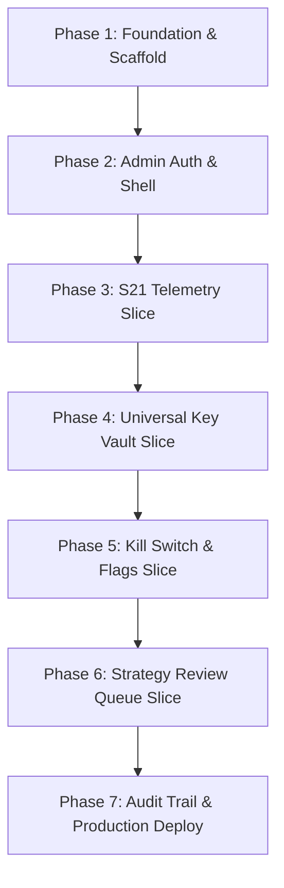

# Step-by-Step Implementation Roadmap: BOLD Admin & Compliance Console
**Document:** PLAN.md  
**Product:** BOLD Control Room (Admin Panel)  
**Target:** React 18+ (TypeScript), Vite, Tailwind CSS, Firebase Hosting (Free Spark Tier)  
**Source of Truth:** [`admin-panel/PRD.md`](file:///d:/trading%20app/admin-panel/PRD.md), [`admin-panel/DESIGN.md`](file:///d:/trading%20app/admin-panel/DESIGN.md), [`admin-panel/ARCHITECTURE.md`](file:///d:/trading%20app/admin-panel/ARCHITECTURE.md), [`admin-panel/DATABASE.md`](file:///d:/trading%20app/admin-panel/DATABASE.md), and [`admin-panel/API.md`](file:///d:/trading%20app/admin-panel/API.md)  

---

## Roadmap Overview & Vertical Slice Strategy
Every phase delivers a fully runnable increment. We do not build all backend endpoints first before touching the frontend; each feature is implemented as an end-to-end vertical slice (Backend Endpoint $\rightarrow$ Database/Cache $\rightarrow$ Frontend UI & Verification).

---

## Phase 1: Foundation, Build System & Design Tokens
**Goal:** Scaffold a clean, runnable React + Vite + TypeScript application configured with the strict `DESIGN.md` design tokens and Firebase Hosting rules.

* [x] **Task 1.1: Initialize Vite Project & Tooling (1.0h)**
  * **What to build:** Initialize Vite with React + TypeScript template, configure `tsconfig.json` path aliases (`@/*` $\rightarrow$ `src/*`), and install Tailwind CSS.
  * **Files touched:** `package.json`, `vite.config.ts`, `tsconfig.json`, `postcss.config.js`.
  * **Dependencies:** None.
  * **Verification:** Run `npm run dev`; local server starts on `http://localhost:5173` without TypeScript or build warnings.

* [x] **Task 1.2: Configure Tailwind Design Tokens & CSS Variables (1.5h)**
  * **What to build:** Add exact tokens from `DESIGN.md` (`#0B0F14` bg, `#121923` surface, `#38D996` bullish, `#FF657A` bearish, `#F3C969` warning, Inter font, tabular figures `tnum`).
  * **Files touched:** `tailwind.config.ts`, `src/index.css`.
  * **Dependencies:** Task 1.1.
  * **Verification:** Inspect element styles on a test card in `App.tsx`; verify background renders `#0B0F14` and borders match `#253140`.

* [x] **Task 1.3: Build Core UI Primitives (Button, Input, Badge, Card) (1.5h)**
  * **What to build:** Implement base Radix/Shadcn wrappers for `Button` (Primary, Destructive, Outline), `Input`, `Badge`, and `Card` handling all states (`default`, `hover`, `focus`, `disabled`).
  * **Files touched:** `src/components/ui/button.tsx`, `src/components/ui/input.tsx`, `src/components/ui/badge.tsx`, `src/components/ui/card.tsx`.
  * **Dependencies:** Task 1.2.
  * **Verification:** Render all button variants in a temporary gallery; verify 2px focus ring (`#38D996`) appears on keyboard tab.

* [x] **Task 1.4: Configure Firebase Hosting Rules & Headers (0.5h)**
  * **What to build:** Set up `firebase.json` for SPA rewrites to `/index.html` and static asset caching headers (`Cache-Control: max-age=31536000`).
  * **Files touched:** `firebase.json`, `.firebaserc`.
  * **Dependencies:** Task 1.1.
  * **Verification:** Run `firebase emulators:start --only hosting`; verify deep links route to index.html without 404s.

> **Phase 1 Definition of Done:** The app runs locally with `npm run dev`, displays token-accurate UI primitives on `#0B0F14` background, and builds cleanly with `npm run build` (< 150 KB gzipped).

---

## Phase 2: Admin Authentication & Shell Layout
**Goal:** Implement Firebase Authentication, role verification, and the persistent Control Room layout.

* [x] **Task 2.1: Firebase Client SDK & Auth Provider (1.5h)**
  * **What to build:** Initialize Firebase Auth client, create `AuthProvider` with token refresh interceptor, and implement `useAuth` hook.
  * **Files touched:** `src/lib/firebase.ts`, `src/features/auth/hooks/useAuth.ts`, `src/app/providers.tsx`.
  * **Dependencies:** Phase 1.
  * **Verification:** Unit test `useAuth` returns loading state initially and user credentials after token resolution.

* [x] **Task 2.2: Admin Login Screen & Session Guard (1.5h)**
  * **What to build:** Build the `/login` view using `#121923` card, email/password inputs with validation, error handling, and `ProtectedRoute` redirect wrapper.
  * **Files touched:** `src/features/auth/components/LoginForm.tsx`, `src/app/router.tsx`.
  * **Dependencies:** Task 2.1.
  * **Verification:** Unauthenticated access to `/overview` redirects to `/login`; entering valid credentials grants access and persists session.

* [x] **Task 2.3: Persistent Admin Layout (Sidebar & Header) (2.0h)**
  * **What to build:** Implement `AdminLayout` with 240px Sidebar (Overview, Keys, Strategies, Feed Health, Governance, Audit) and Topbar (SANDBOX/LIVE environment pill, IST clock, user profile).
  * **Files touched:** `src/components/layout/AdminLayout.tsx`, `src/components/layout/Sidebar.tsx`, `src/components/layout/Header.tsx`.
  * **Dependencies:** Task 2.2.
  * **Verification:** Navigating between sidebar tabs updates route URL, highlights the active tab with `#38D996` left border, and displays real-time IST clock.

> **Phase 2 Definition of Done:** Authenticated users can log in, navigate the 6 sidebar sections within the admin shell, and log out with secure session invalidation.

---

## Phase 3: Screen S21 Telemetry & Feed Health Slice
**Goal:** Deliver the end-to-end S21 Platform Overview dashboard with live feed health and latency charts.

* [x] **Task 3.1: Telemetry Data Models & API Client (1.0h)**
  * **What to build:** TypeScript interfaces for telemetry overview and latency series matching `API.md` Section 2.2; configure Axios GET endpoints.
  * **Files touched:** `src/types/telemetry.ts`, `src/features/overview/services/telemetryService.ts`.
  * **Dependencies:** Phase 2.
  * **Verification:** Mock API returns 200 OK with expected JSON structure; schema validates via TypeScript without type errors.

* [x] **Task 3.2: Overview Metric Cards Component (1.5h)**
  * **What to build:** 4 high-density metric cards: Total Users (`24,860`), Active Subscriptions (`4,218`), Feed Health (`DEGRADED` / `HEALTHY`), and API Error Rate (`0.42%`).
  * **Files touched:** `src/features/overview/components/MetricCard.tsx`, `src/features/overview/components/OverviewGrid.tsx`.
  * **Dependencies:** Task 3.1.
  * **Verification:** Render cards with `tnum` numbers; status badge switches color between `#38D996` (Normal) and `#F3C969` (Degraded) based on payload.

* [x] **Task 3.3: Feed Latency Timeseries Chart (1.5h)**
  * **What to build:** Canvas/SVG area chart plotting 60 latency points (0–800ms) with threshold line at 500ms and active incident list.
  * **Files touched:** `src/features/overview/components/FeedLatencyChart.tsx`.
  * **Dependencies:** Task 3.1.
  * **Verification:** Hovering over chart points displays tooltip with exact IST timestamp, latency in ms, and error percentage.

> **Phase 3 Definition of Done:** Navigating to `/overview` loads Screen S21, displays 4 live metric cards, auto-polls every 15 seconds via TanStack Query, and renders the latency chart without DOM lag.

---

## Phase 4: Universal Key & Secret Vault Slice
**Goal:** Deliver the Key Management Hub to store, mask, test ping, and rotate external API keys.

* [x] **Task 4.1: Key Vault Table & Masked Display (1.5h)**
  * **What to build:** Data table listing providers (`gemini_api`, `zerodha_kite`, `truedata_feed`), masked keys (`••••••••9A12`), quota bars, and status badges.
  * **Files touched:** `src/types/keys.ts`, `src/features/keys/components/KeyListTable.tsx`, `src/features/keys/hooks/useKeyManager.ts`.
  * **Dependencies:** Phase 2.
  * **Verification:** Table renders 7 providers; secrets are strictly masked; clicking copy icon copies masked string with toast notification.

* [x] **Task 4.2: Upstream Connection Test Ping (1.0h)**
  * **What to build:** "Test Ping" button firing `POST /v1/admin/keys/{provider}/test-ping`; displays loading spinner and updates latency badge.
  * **Files touched:** `src/features/keys/components/TestPingButton.tsx`.
  * **Dependencies:** Task 4.1.
  * **Verification:** Triggering test ping updates latency metric (e.g., `128ms`) and status badge turns green (`valid`).

* [x] **Task 4.3: Secret Key Rotation Modal & Validation (2.0h)**
  * **What to build:** Dialog modal prompting for new secret key with client-side Zod validation, "Verify Upstream" checkbox, and save confirmation.
  * **Files touched:** `src/features/keys/components/RotateKeyDialog.tsx`, `src/lib/validations.ts`.
  * **Dependencies:** Task 4.1.
  * **Verification:** Submitting valid key sends payload to `/rotate`; table updates with new masked suffix and timestamp without full page reload.

> **Phase 4 Definition of Done:** Operators can view all platform API keys, test upstream health, and rotate credentials with immediate optimistic UI updates and zero plain-text leaks in client DOM.

---

## Phase 5: Governance, Feature Flags & Emergency Kill Switch Slice
**Goal:** Deliver system-wide feature flags and the master emergency kill switch.

* [x] **Task 5.1: Master Emergency Kill Switch Banner & Modal (1.5h)**
  * **What to build:** Top alert banner with master toggle: "HALT ALL SIGNALS & SIMULATIONS"; requires typing "CONFIRM FREEZE" in confirmation modal.
  * **Files touched:** `src/features/governance/components/KillSwitchBanner.tsx`, `src/components/feedback/KillSwitchModal.tsx`.
  * **Dependencies:** Phase 2.
  * **Verification:** Confirming freeze dispatches `POST /v1/admin/governance/kill-switch`; banner shifts to red border with glowing alert badge.

* [x] **Task 5.2: Feature Flags Management List (1.5h)**
  * **What to build:** List of toggles for `GLOBAL_FREE_TIER_OVERRIDE`, `F_AND_O_CHAIN_ENABLED`, and `AI_RESEARCH_ASSISTANT`; toggles save with optimistic updates.
  * **Files touched:** `src/features/governance/components/FeatureFlagsList.tsx`, `src/features/governance/hooks/useGovernance.ts`.
  * **Dependencies:** Phase 2.
  * **Verification:** Toggling flag updates local state immediately; failure triggers error toast and rolls back switch.

> **Phase 5 Definition of Done:** Operators can trigger the emergency kill switch with dual confirmation and toggle platform feature flags.

---

## Phase 6: Strategy Review & Compliance Queue Slice
**Goal:** Deliver the review queue for algorithmic strategies before they broadcast to the mobile signals feed.

* [x] **Task 6.1: Strategy Review Queue Table (1.5h)**
  * **What to build:** Filterable table by risk (`Low`, `Medium`, `High`) and status (`Pending`, `Approved`); displays Win Rate %, Drawdown %, and submitter.
  * **Files touched:** `src/types/strategy.ts`, `src/features/strategies/components/StrategyQueueTable.tsx`.
  * **Dependencies:** Phase 2.
  * **Verification:** Table displays mock queue (`NIFTY Momentum v1.4`, etc.) and filters accurately when risk chips are clicked.

* [x] **Task 6.2: Strategy Detail Drawer & Decision Actions (2.0h)**
  * **What to build:** Slide-out drawer displaying full rule conditions (Entry, Exit, Stop Loss), backtest summary, and Approve / Request Changes buttons.
  * **Files touched:** `src/features/strategies/components/StrategyDetailDrawer.tsx`.
  * **Dependencies:** Task 6.1.
  * **Verification:** Clicking "Approve" dispatches decision to backend; row status changes to `Approved` with reviewer timestamp.

> **Phase 6 Definition of Done:** Compliance officers can inspect strategy condition trees and approve or reject models with audit logging.

---

## Phase 7: Audit Trail, Hardening & Firebase Deployment
**Goal:** Finalize the tamper-evident audit viewer, run accessibility & bundle audits, and deploy to Firebase Hosting.

* [x] **Task 7.1: Tamper-Evident Audit Trail Viewer (1.5h)**
  * **What to build:** Paginated table displaying event hashes (`EVT_10482`), actor emails, action categories, and IP addresses with search filter.
  * **Files touched:** `src/types/audit.ts`, `src/features/audit/components/AuditLogTable.tsx`.
  * **Dependencies:** Phase 2.
  * **Verification:** Typing an IP or action category filters the log instantly; clicking a row expands JSON `state_before` and `state_after`.

* [x] **Task 7.2: WCAG 2.1 AA Accessibility & Keyboard Nav Audit (1.0h)**
  * **What to build:** Verify 4.5:1 contrast ratios on dark mode tokens, ensure visible 2px focus rings on all interactive elements, and verify screen reader labels.
  * **Files touched:** Global CSS & component templates.
  * **Dependencies:** Phases 1–6.
  * **Verification:** Tab navigation reaches every button and modal in sequence without focus traps; contrast checker passes 100%.

* [x] **Task 7.3: Production Build Optimization & Firebase Deployment (1.0h)**
  * **What to build:** Configure dynamic code splitting for `/audit` and `/strategies` routes; deploy to Firebase Hosting.
  * **Files touched:** `vite.config.ts`, `firebase.json`.
  * **Dependencies:** Tasks 7.1, 7.2.
  * **Verification:** Run `npm run build`; verify total gzipped bundle size < 200 KB; live URL serves SPA cleanly with HTTPS.

> **Phase 7 Definition of Done:** The admin panel is live on Firebase Hosting, passing all build, lint, and security checks with complete feature coverage.
