# Product Requirements Document (PRD)
## BOLD Admin & Compliance Console (Control Room)
**Version:** 1.0  
**Status:** Ready for Review  
**Tech Stack:** React (SPA, Vite, Tailwind CSS / Shadcn UI)  
**Hosting Infrastructure:** Firebase Hosting (Free Spark Tier Compatible)  
**Parent Specification:** BOLD UI/UX Design Brief Screen S21 ("Platform Overview / Control Room")  
**Primary Focus:** Platform Health, Universal Key & Secret Management, Feature Governance, and Strategy Approvals

---

## 1. Problem Statement & Target Users

### 1.1 Problem Statement
Operating a multi-broker trading and research mobile app requires constant configuration updates:
1. **Hardcoded Secrets & Deployment Friction:** If market data feed keys, AI API keys, or broker OAuth credentials change or get rate-limited, requiring an app rebuild or backend redeployment causes critical downtime.
2. **Regulatory Risk & Compliance Gaps:** SEBI guidelines require oversight over algorithmic strategies, signal distribution, and data integrity. There must be an administrative layer to review strategies before they broadcast to users, monitor stale data alerts, and instantly trigger platform-wide kill switches.
3. **Free Launch Governance:** All features are free at launch, but platform operators need the ability to tune global entitlements, toggle feature flags, and manage resource quotas without rewriting code or paying hosting costs.

The **BOLD Admin & Compliance Console** is a lightweight, responsive React web application hosted free on **Firebase Hosting**. It provides an operational "Control Room" to securely manage all API keys, monitor broker adapters, approve quant strategies, audit system logs, and control feature flags.

---

### 1.2 Target User Personas

#### Persona 1: Operations & DevOps Admin (Vikram, 32)
* **Role:** Platform reliability and infrastructure administrator.
* **Pain Points:** Needs to monitor feed health across NSE and BSE adapters and rotate third-party API keys (e.g., Gemini AI, Market Data, Broker API tokens) securely without redeploying microservices.
* **Goals:** View live latency/error rate metrics, receive alerts on degraded adapters, and rotate expired API credentials with one click.

#### Persona 2: Research & Compliance Lead (Sunita, 40)
* **Role:** Head of research and regulatory compliance.
* **Pain Points:** Risk of unverified quantitative models publishing misleading signals or violating SEBI retail advisory regulations.
* **Goals:** Review algorithmic strategy drafts submitted by researchers, approve/reject them before they appear in the mobile app signals feed, and manage required legal disclosures and source templates.

#### Persona 3: Product Manager (Sameer, 29)
* **Role:** Growth and user experience manager.
* **Pain Points:** Needs to configure which features are accessible, ensure all features remain 100% free during beta, and monitor user adoption metrics without querying the production database manually.
* **Goals:** Enable/disable beta features via feature flags and monitor daily active users and paper-trading volume.

---

## 2. Goals and Non-Goals

### 2.1 Product Goals
* **Zero-Cost Hosting on Firebase:** Static Single-Page Application (SPA) built with React, deployed to Firebase Hosting on the free tier.
* **Universal Key & Secret Management:** Admin UI to store, update, test, and rotate all external API keys:
  * Market Data Feed Keys (e.g., TrueData, GlobalDataFeeds, Broker Data APIs).
  * Broker Application Credentials (API Key & Secret for Zerodha, Upstox, Angel One, Dhan, Fyers, 5paisa, ICICI Direct).
  * AI Provider Keys (Google Gemini API / OpenAI API keys for Screen S10).
  * Push Notification Credentials (Firebase Cloud Messaging service account).
* **Live System Health & Telemetry:** Visual monitoring of API latency, error rates (< 0.50% threshold), and adapter degradation.
* **Emergency Platform Kill Switch:** Instant button to freeze signal broadcasting or disable paper execution in case of anomalous market data.
* **Strategy Approval Queue:** Workflow for approving or requesting changes on quantitative models before public availability.
* **Global Free-Tier Control:** Ensure all mobile features remain unlocked for 100% free usage at launch.

### 2.2 Non-Goals
* **No Client Trading / Market Charting:** The console is for back-office administration only, not for executing orders or viewing stock charts.
* **No Direct Plain-Text Storage of Secrets:** Keys submitted via the admin panel are encrypted server-side with AES-256 and masked in the UI (`sk-••••••••`).
* **No Billing / Payment Processing:** Since all features are 100% free at start, billing gateway integrations (Stripe/Razorpay) are out of scope for V1.
* **No High-Cost Paid Infrastructure:** Kept strictly within Firebase Free Spark tier limits (10 GB storage, 360 MB/day data transfer, zero hosting fee).

---

## 3. Core Features Split: MVP, V2, and Later

```mermaid
flowchart LR
    subgraph MVP ["MVP (Must-Have: Weeks 1-6)"]
        A1["Secure Admin Authentication"]
        A2["Universal Key & Secret Manager"]
        A3["Feature Flags & Free-Tier Enabler"]
        A4["Emergency Kill Switch"]
        A5["Platform Health Dashboard"]
    end
    subgraph V2 ["V2 (Should-Have: Weeks 7-12)"]
        A6["Strategy Review & Approval Queue"]
        A7["Broker Adapter Health Monitor"]
        A8["User Management & Session Revoke"]
        A9["Tamper-Evident Audit Logs"]
    end
    subgraph Later ["Later (Nice-to-Have: Weeks 13+)"]
        A10["Automated API Key Health Checks"]
        A11["Regulatory Disclosure Generator"]
        A12["Commercial Plan Configuration"]
    end
    MVP --> V2 --> Later
```

### 3.1 MVP (Must-Have — Small & Shippable)
| Module | Feature | Description |
| :--- | :--- | :--- |
| **Auth** | **Firebase Admin Login** | Secure email/password login restricted strictly to authorized admin emails with Firebase Auth. |
| **Key Manager** | **API Key Management Hub** | UI to add, update, and mask all platform keys: Market Data API keys, Broker OAuth Client IDs/Secrets, AI API keys, and FCM push keys. |
| **Governance** | **Free Tier & Feature Flags** | Global switch setting all features to `FREE_TIER = true` and toggling modules (Scanner, Strategy Builder, Options Chain) on/off. |
| **Security** | **Platform Emergency Kill Switch**| High-visibility toggle to freeze all signal generation and paper order simulation during market data anomalies. |
| **Health** | **Telemetry Overview** | Dashboard cards for Total Users, Active Subscriptions (Free), Feed Health (Normal/Degraded), and API Error Rate (`S21`). |

### 3.2 V2 (Should-Have — Compliance & Governance)
| Module | Feature | Description |
| :--- | :--- | :--- |
| **Algo Lab** | **Strategy Approval Queue** | Review queue for strategies submitted by the quant team: inspect rules, indicators, backtest metrics, and mark as `Approved` or `Changes Requested`. |
| **Brokers** | **Broker Adapter Status** | Individual status cards for Zerodha, Upstox, Angel One showing connection health, token expiry, and error count. |
| **Users** | **User Management** | Search registered users by phone/email, inspect virtual portfolio balance, and terminate suspicious active sessions. |
| **Audit** | **Audit Trail Viewer** | Filterable log recording who changed an API key, approved a strategy, or activated a kill switch with timestamp and IP address. |

### 3.3 Later (Nice-to-Have — Automation & Commercialization)
| Module | Feature | Description |
| :--- | :--- | :--- |
| **Keys** | **Automated Health Ping** | Background cron pinging configured API keys to verify quota limits before they fail in production. |
| **Compliance** | **Legal Disclosure Manager** | Form to update SEBI-mandated market risk disclaimers across the mobile app dynamically. |
| **Billing** | **Tier Pricing Editor** | Configuration of monthly/annual pricing when monetization is ready to be launched. |

---

## 4. User Stories

### Key & Secret Management
* **US01:** *As an operations admin*, I want to paste my new Google Gemini / OpenAI API key into the Key Management panel, *so that* the mobile AI research assistant (`S10`) starts functioning without redeploying backend code.
* **US02:** *As an admin*, I want all stored API secrets to be masked (`••••••••abcd`) and only revealed with two-factor verification, *so that* credentials are not exposed to onlookers.
* **US03:** *As an admin*, I want to enter Zerodha Kite and Upstox OAuth Client IDs and Secrets, *so that* the mobile app can connect to broker authorization endpoints securely.

### Platform Health & Emergency Control
* **US04:** *As an operations admin*, I want to see real-time error rates and feed latency for NSE and BSE feeds on the dashboard, *so that* I can spot data degradation before users report it.
* **US05:** *As a compliance officer*, I want a one-click Emergency Kill Switch that immediately locks live signal generation and alerts all users, *so that* users are protected if an authorized feed sends corrupted ticks.

### Strategy Governance & Feature Flags
* **US06:** *As a compliance lead*, I want to inspect a quant strategy's rule parameters, stop-loss rules, and backtest results in a review queue, *so that* only validated, risk-checked setups are published to the mobile signals feed (`S15`).
* **US07:** *As a product manager*, I want to toggle a global "All Features Free" flag, *so that* early mobile users get unrestricted access to the advanced scanner and F&O desk without payment friction.

---

## 5. Key User Flows (Step-by-Step)

### Flow 1: Updating an API Key (Zero-Downtime Secret Rotation)
1. Admin opens the React console hosted on Firebase (`https://bold-admin.web.app`).
2. Logs in via Firebase Authentication $\rightarrow$ Reaches `Platform Overview` (`S21`).
3. Selects **Data & APIs / Key Manager** from the sidebar navigation.
4. Locates the **AI Research Provider (Gemini API)** card $\rightarrow$ Current status shows: `Active (Quota 82% used)`.
5. Clicks **Rotate Key** $\rightarrow$ Modal opens prompting for the new API Key.
6. Admin pastes the new API Key $\rightarrow$ Clicks **Test Connection**.
7. System fires a test ping to the API endpoint $\rightarrow$ Status returns `200 OK (Latency: 140ms)`.
8. Admin clicks **Save & Deploy** $\rightarrow$ Encrypted key is updated in the backend cache $\rightarrow$ Audit trail logs event `EVT 10484: Gemini API Key Rotated by admin@bold.app`.

### Flow 2: Activating the Platform Emergency Kill Switch
1. Admin receives an alert: `P2 NSE Adapter: Elevated latency (780ms) and corrupted volume ticks`.
2. Admin logs into the Admin Console $\rightarrow$ Banner shows **Feed Health: Degraded**.
3. Admin clicks **Feature Flags & Emergency Controls** in the navigation.
4. Clicks the toggle **Signal Generation & Paper Orders** $\rightarrow$ Prompts confirmation modal: *"Are you sure you want to pause all simulations and signals?"*.
5. Admin clicks **Confirm Freeze**.
6. Backend immediately sets `KILL_SWITCH_ACTIVE = true` in Redis cache.
7. Mobile clients immediately display a warning banner: *"Market feed undergoing maintenance. New signals and paper orders temporarily paused."*

### Flow 3: Reviewing & Approving a Quantitative Strategy
1. Research lead navigates to **Strategy Approvals Queue**.
2. Selects `NIFTY Momentum v1.4` submitted by the Quant Team.
3. Reviews logic: Entry (EMA 20 > EMA 50 & RSI > 55), Exit (Close < EMA 20 or 2R), Risk (1% stop loss, 2% daily cap).
4. Inspects Backtest summary: Win rate 58.6%, Max Drawdown 6.20%, modelled slippage and taxes included.
5. Clicks **Approve for Signals Feed** $\rightarrow$ Status changes to `Approved`.
6. Strategy is instantly scheduled for signal generation on the mobile app (`S15`).

---

## 6. Success Metrics

| Metric Category | Target | Description |
| :--- | :--- | :--- |
| **Hosting Cost** | **$0.00 / month** | 100% within Firebase Free Spark tier allowances. |
| **Key Update Speed** | < 2 seconds | Time taken for a new API key to take effect platform-wide. |
| **Kill Switch Latency**| < 500 ms | Time for backend/Redis to halt signal distribution once triggered. |
| **Console Load Time** | < 1.5 seconds | Fast, lightweight React bundle (< 250 KB gzipped). |
| **Audit Completeness** | 100% | Zero unlogged administrative actions. |

---

## 7. Risks, Assumptions, and Open Questions

### Risks
* **Secret Leakage from Client:** The React admin panel must **never** bundle API secrets in static frontend JavaScript files. All keys must be saved directly to the secure backend / Firebase Cloud Functions with strict server-side rules.
* **Firebase Free Tier Quota Limits:** Firebase Hosting is free (10 GB storage, 360 MB/day transfer), but if admin logs generate millions of reads/writes on free Firestore, it could exceed Spark limits. Mitigation: Use efficient pagination and cache query results in memory.
* **Accidental Kill Switch Triggering:** Inadvertently pressing the kill switch during trading hours halts user simulation. Mitigation: Require two-step confirmation dialogs for all critical actions.

### Assumptions
* Admin panel is accessed via modern desktop browsers (Chrome, Edge, Safari).
* React 18+ with Vite and Tailwind CSS will be used for rapid, clean component development.
* Firebase project is created with Firebase Auth (Email/Password or Google Workspace OAuth restricted to the company domain).

### Open Questions
1. Do you want the React admin panel to communicate directly with your Python/FastAPI backend, or use Firebase Firestore as an intermediary configuration database?
2. Which initial market data feed provider (TrueData, Zerodha Kite historical API, or a mock generator) will be the primary source for testing?
