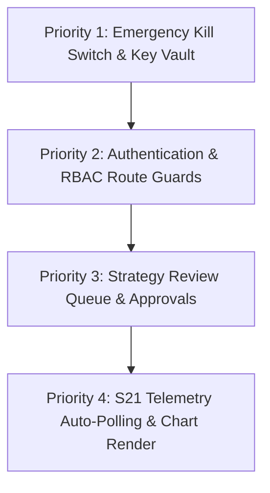

# Testing Strategy & Test Plan: Admin & Compliance Console
**Document:** TESTING.md  
**Product:** BOLD Control Room (Admin Panel)  
**Target:** React 18+ (Vite, TypeScript, Tailwind CSS, Firebase Hosting)  
**Source of Truth:** [`admin-panel/PRD.md`](file:///d:/trading%20app/admin-panel/PRD.md), [`admin-panel/FEATURES.md`](file:///d:/trading%20app/admin-panel/FEATURES.md), [`admin-panel/API.md`](file:///d:/trading%20app/admin-panel/API.md), and [`admin-panel/AUTH_SECURITY.md`](file:///d:/trading%20app/admin-panel/AUTH_SECURITY.md)  

---

## 1. Testing Tools & Architecture

| Layer | Tool | One-Line Justification |
| :--- | :--- | :--- |
| **Unit & Component Testing** | **Vitest + React Testing Library** | Native Vite integration delivering ultra-fast test execution and DOM-based component assertions. |
| **Mocking & API Simulation** | **Mock Service Worker (MSW v2)** | Intercepts HTTP requests at the network layer to simulate backend REST responses and error states. |
| **End-to-End (E2E) Testing** | **Playwright** | Multi-browser headless automation validating complete user flows (login, key rotation, kill switch). |
| **Code Coverage** | **@vitest/coverage-v8** | Fast, V8-native AST code coverage reporting against established thresholds. |

---

## 2. Test Priorities by Layer (Critical Paths First)



1. **Priority 1 (Critical Security & Governance):**
   * Emergency Kill Switch activation barrier (typed confirmation requirement).
   * Key Vault rotation payload encryption, masking, and upstream test ping handling.
2. **Priority 2 (Authentication & Access Control):**
   * Firebase JWT expiration handling, unauthorized redirects, and role-based action gating.
3. **Priority 3 (Compliance Workflow):**
   * Strategy approval/rejection state transitions and mandatory review note validation.
4. **Priority 4 (Telemetry & Visual Rendering):**
   * Feed latency threshold color switching (`#38D996` $\rightarrow$ `#F3C969`), 15s auto-polling, and empty incident states.

---

## 3. Test Cases by Feature

### Feature A1: Firebase Admin Auth & Session Guard
| Case ID | Scenario | Input / Action | Expected Result |
| :--- | :--- | :--- | :--- |
| **TC-A1-01** | Valid Admin Login | Valid email (`ops.admin@boldtrading.internal`) + valid password | Authenticates via Firebase; sets session state; navigates to `/overview`. |
| **TC-A1-02** | Invalid Password | Valid email + incorrect password | Shows error banner: *"Invalid email or password"*; remains on `/login`. |
| **TC-A1-03** | Malformed Email | Input: `"not-an-email"` | Client Zod validation blocks submit; displays *"Invalid email address"*. |
| **TC-A1-04** | Route Guard Protection | Direct URL navigation to `/keys` without token | Automatically redirects to `/login?redirect=/keys`. |
| **TC-A1-05** | Suspended Account | Account with `is_active = false` logs in | Backend returns `403 Forbidden`; UI signs out user and displays suspension alert. |

---

### Feature A2: Screen S21 Telemetry & Platform Overview
| Case ID | Scenario | Input / Action | Expected Result |
| :--- | :--- | :--- | :--- |
| **TC-A2-01** | Metric Cards Render | Telemetry returns 200 OK | Displays `24,860` users, `4,218` subs, and `0.42%` error rate in tabular typography. |
| **TC-A2-02** | Feed Degradation Alert | Backend emits adapter latency > 500ms | Feed Health badge shifts from Green (`HEALTHY`) to Yellow `#F3C969` (`DEGRADED`). |
| **TC-A2-03** | Auto-Polling Interval | Wait 15 seconds on `/overview` | React Query dispatches background refetch without UI flickering or layout shifts. |
| **TC-A2-04** | Latency Chart Hover | Mouse hover over latency chart point at index 30 | Tooltip appears with exact IST timestamp, latency in ms, and error rate. |
| **TC-A2-05** | Backend Telemetry Down | API returns `503 Service Unavailable` | Displays warning toast: *"Telemetry feed stale. Retrying..."*; keeps last valid cache. |

---

### Feature A3: Universal Key & Secret Management Vault
| Case ID | Scenario | Input / Action | Expected Result |
| :--- | :--- | :--- | :--- |
| **TC-A3-01** | Masked Display Check | Load `/keys` table | Secrets are strictly masked (`sk-gemini-••••••••9A12`); raw secrets absent in DOM. |
| **TC-A3-02** | Test Ping Upstream | Click "Test Ping" on `gemini_api` | Button shows spinner; returns `200 OK`; updates latency badge to `128ms`. |
| **TC-A3-03** | Rotate Key Success | Submit new key string with "Verify Upstream" checked | Upstream validates; returns `200 OK`; table updates masked suffix and rotation time. |
| **TC-A3-04** | Rotate Key Upstream Failure | Submit invalid/revoked API key | Upstream returns 400; dialog displays error alert; key is NOT saved to database. |
| **TC-A3-05** | Copy Masked Key | Click copy icon next to key | Clipboard receives masked string; toast displays: *"Masked key copied to clipboard"*. |

---

### Feature A4: Platform Emergency Kill Switch & Feature Flags
| Case ID | Scenario | Input / Action | Expected Result |
| :--- | :--- | :--- | :--- |
| **TC-A4-01** | Kill Switch Safety Barrier | Click toggle; submit modal without typing confirmation | Confirm button is disabled; freeze is prevented. |
| **TC-A4-02** | Kill Switch Activation | Type `"CONFIRM FREEZE"` and submit | Fires `POST /kill-switch`; banner displays red glowing alert; halts simulations. |
| **TC-A4-03** | Feature Flag Toggle | Toggle `GLOBAL_FREE_TIER_OVERRIDE` | Optimistically flips toggle; sends PATCH payload; updates state in Redis/PostgreSQL. |
| **TC-A4-04** | Feature Flag Rollback | Backend returns `500 Server Error` on toggle | Reverts toggle to original state; displays error toast notification. |

---

### Feature A5: Strategy Review & Compliance Queue
| Case ID | Scenario | Input / Action | Expected Result |
| :--- | :--- | :--- | :--- |
| **TC-A5-01** | Risk Filter Selection | Click risk chip `High` | Table filters to show only high-risk strategies; pagination recalculates. |
| **TC-A5-02** | Drawer Logic Inspection | Click row `NIFTY Momentum v1.4` | Slide-out drawer opens showing Entry/Exit condition AST and backtest equity curve. |
| **TC-A5-03** | Strategy Approval Flow | Click "Approve" button in drawer | Status changes to `Approved`; row moves to approved section; audit log records event. |
| **TC-A5-04** | Reject Without Notes | Click "Reject" with empty review notes | Validation error triggers: *"Review notes are required for rejection (min 10 chars)"*. |

---

### Feature A6: Tamper-Evident Audit Trail Viewer
| Case ID | Scenario | Input / Action | Expected Result |
| :--- | :--- | :--- | :--- |
| **TC-A6-01** | Audit Search Filter | Type `"ops.admin@boldtrading.internal"` in search | Filters table within 300ms (debounced) displaying matching audit rows. |
| **TC-A6-02** | State Diff Expansion | Click audit row `EVT_10482` | Expands collapsible section rendering formatted JSON `state_before` and `state_after`. |
| **TC-A6-03** | Append-Only Verification | Inspect UI table actions | Zero edit or delete actions exist for audit rows in UI or network layer. |

---

## 4. Test Data & Mocking Strategy

### 4.1 Mock Service Worker (MSW) Handlers
All integration tests utilize MSW handlers defined in `src/test/mocks/handlers.ts`:
```typescript
import { http, HttpResponse } from 'msw';

export const handlers = [
  // Mock Telemetry Overview
  http.get('*/v1/admin/telemetry/overview', () => {
    return HttpResponse.json({
      total_users: 24860,
      active_subscriptions: 4218,
      overall_feed_health: 'degraded',
      api_error_rate_percent: 0.42,
      active_kill_switch: false
    });
  }),

  // Mock Key Rotation
  http.post('*/v1/admin/keys/:provider/rotate', async ({ request }) => {
    const body = await request.json() as { raw_secret: string };
    if (body.raw_secret === 'INVALID_KEY') {
      return HttpResponse.json({ error: { message: 'Invalid API key provided' } }, { status: 422 });
    }
    return HttpResponse.json({ message: 'Rotated successfully', status: 'valid' });
  })
];
```

---

## 5. Coverage Targets & Execution Commands

### 5.1 Coverage Thresholds
* **Overall Code Coverage:** Minimum **80%** lines, branches, and functions.
* **Critical Security & Governance Modules (`features/governance/`, `features/keys/`):** Minimum **95%** branch coverage.

### 5.2 Test Execution Commands

```bash
cd admin-panel

# Run all unit and component tests
npm test

# Run tests in watch mode during development
npx vitest

# Generate code coverage report
npx vitest run --coverage

# Run End-to-End browser tests (Playwright)
npx playwright test

# Run a specific feature test suite
npx vitest run src/features/keys/components/KeyListTable.test.tsx
```

---

## 6. Pre-Release Manual QA Checklist

* [ ] **Visual Theme Verification:** Verify background is `#0B0F14`, cards are `#121923`, and borders are `#253140`.
* [ ] **Kill Switch Typing Verification:** Verify the Master Kill Switch cannot be engaged by accident.
* [ ] **Secret Masking Audit:** Inspect browser DevTools DOM elements; verify plain-text secrets are nowhere in the DOM.
* [ ] **Keyboard Navigation (WCAG 2.1 AA):** Tab through the entire dashboard; verify 2px focus ring on every element.
* [ ] **Network Failure Handling:** Disconnect network in DevTools; verify stale data toasts appear without white-screen crashes.
