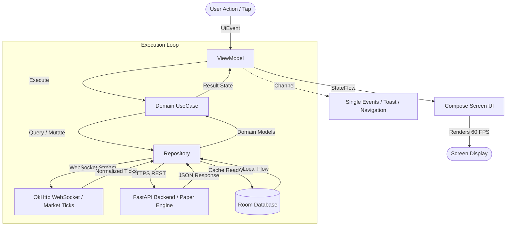

# System Architecture Specification: BOLD Mobile Application
**Document:** ARCHITECTURE.md  
**Product:** BOLD Android Trading & Research Platform  
**Target:** Native Android (Kotlin + Jetpack Compose)  
**Source of Truth:** [`mobile-application/PRD.md`](file:///d:/trading%20app/mobile-application/PRD.md) and [`mobile-application/DESIGN.md`](file:///d:/trading%20app/mobile-application/DESIGN.md)  

---

## 1. Recommended Tech Stack

| Layer / Concern | Technology | One-Line Justification |
| :--- | :--- | :--- |
| **Language** | **Kotlin 2.0+** | Modern, null-safe, concise language mandated for enterprise Android development. |
| **UI Toolkit** | **Jetpack Compose + Material 3** | Declarative, reactive UI toolkit delivering instantaneous rendering for volatile market data. |
| **Architecture Pattern** | **Unidirectional Data Flow (UDF / MVI)** | Predictable, unidirectional state streams (`StateFlow`) isolating UI rendering from business logic. |
| **Dependency Injection**| **Hilt (Dagger)** | Google's standard compile-time dependency injection ensuring modular decoupling across feature modules. |
| **Asynchronous Engine** | **Kotlin Coroutines & Flow** | Structured concurrency handling non-blocking background calculations and real-time WebSocket tick streams. |
| **REST Networking** | **Retrofit 2 + OkHttp 4** | Type-safe HTTP client with connection pooling, request interceptors, and automated JSON serialization. |
| **Real-Time Streaming** | **OkHttp WebSocket** | Low-latency bi-directional socket streaming normalized market ticks and simulated order fill events. |
| **Local Cache & Storage**| **Room Database (SQLite)** | Compile-time verified SQLite abstraction for caching candles, watchlists, and offline strategy drafts. |
| **Preferences Storage** | **Jetpack DataStore (Preferences)** | Secure, coroutine-based asynchronous key-value storage replacing legacy SharedPreferences. |
| **Charting Engine** | **Custom Compose Canvas & Vico** | High-performance hardware-accelerated 60 FPS candlestick, volume, and payoff diagram rendering. |

---

## 2. Complete Folder and File Structure (Multi-Module Tree)

The project adheres to the multi-module architecture mandated in Section 11 of the BOLD developer handoff:

```text
mobile-application/
├── build.gradle.kts                 # Root Gradle build configuration
├── settings.gradle.kts              # Module inclusion tree
├── gradle.properties
├── .gitignore
│
├── build-logic/                     # Gradle convention plugins for shared configurations
│   └── convention/
│       ├── AndroidApplicationConventionPlugin.kt
│       ├── AndroidLibraryConventionPlugin.kt
│       └── AndroidComposeConventionPlugin.kt
│
├── app/                             # Application module (Assembly & Navigation root)
│   ├── build.gradle.kts
│   └── src/main/
│       ├── AndroidManifest.xml
│       └── java/com/bold/trading/
│           ├── BoldApplication.kt   # Hilt Android Application entry point
│           ├── MainActivity.kt      # Single-activity host with Compose Scaffold
│           ├── di/AppModule.kt      # Top-level DI bindings
│           └── navigation/
│               ├── BoldNavHost.kt   # Top-level navigation graph connecting S01–S20
│               └── BottomNavBar.kt  # 5-tab persistent bottom bar
│
├── core/                            # Shared core modules (Zero feature-to-feature dependencies)
│   ├── designsystem/                # Strict UI tokens from DESIGN.md
│   │   ├── Color.kt                 # #0B0F14, #121923, #38D996, #FF657A tokens
│   │   ├── Typography.kt            # Inter font styles with tabular numeral feature ("tnum")
│   │   ├── Theme.kt                 # BoldTheme dynamic dark/light provider
│   │   └── components/              # Buttons, inputs, chips, cards, dialogs
│   │
│   ├── networking/                  # Remote networking engine
│   │   ├── ApiEndpoints.kt          # BOLD backend REST route contracts
│   │   ├── WebSocketManager.kt      # Multiplexed real-time market tick stream
│   │   ├── AuthInterceptor.kt       # Injects Bearer token into outgoing requests
│   │   └── model/NetworkResult.kt   # Sealed class for Success, Error, and Loading
│   │
│   ├── database/                    # Local persistence
│   │   ├── BoldDatabase.kt          # Room database definition
│   │   ├── dao/                     # WatchlistDao, CandleDao, StrategyDraftDao
│   │   └── entity/                  # WatchlistEntity, InstrumentEntity
│   │
│   ├── common/                      # Shared helpers and base interfaces
│   │   ├── dispatchers/             # Injected CoroutineDispatchers (IO, Default, Main)
│   │   ├── formatters/              # Indian Rupee (₹), percentage, and IST formatters
│   │   └── extensions/              # Flow and Compose modifier utilities
│   │
│   └── charts/                      # Technical charting canvas primitives
│       ├── CandlestickCanvas.kt     # Hardware-accelerated OHLC rendering
│       ├── IndicatorRenderers.kt    # EMA, VWAP, RSI sub-chart canvas
│       └── PayoffDiagramCanvas.kt   # F&O strategy profit/loss curve canvas
│
└── feature/                         # Feature modules (isolated domain + UI + ViewModel)
    ├── onboarding/                  # Screens S01, S02, S03 (Auth, OTP, Setup)
    │   ├── OnboardingScreen.kt
    │   ├── AuthViewModel.kt
    │   └── PersonalizationScreen.kt
    ├── dashboard/                   # Screen S04 (Home terminal overview)
    │   ├── DashboardScreen.kt
    │   └── DashboardViewModel.kt
    ├── market/                      # Screen S05 (Market overview, sector heatmap)
    ├── watchlist/                   # Screen S06 (Multi-watchlist, symbol search)
    ├── charts/                      # Screen S07 (Advanced full-screen chart)
    ├── scanner/                     # Screen S08 (Market scanner presets & rules)
    ├── research/                    # Screens S09, S10 (Fundamentals & AI Assistant)
    ├── options/                     # Screen S11 (F&O trade desk & Option Chain)
    ├── algo/                        # Screen S12 (Strategy rule builder)
    ├── backtest/                    # Screen S13 (Historical backtest equity curves)
    ├── papertrading/                # Screen S14 (Virtual terminal & order ticket)
    │   ├── PaperTerminalScreen.kt
    │   ├── OrderTicketBottomSheet.kt
    │   └── PaperTerminalViewModel.kt
    ├── signals/                     # Screen S15 (Real-time signals feed)
    ├── portfolio/                   # Screen S16 (Virtual ledger & trade journal)
    ├── brokers/                     # Screen S17 (Read-only broker sync hub)
    ├── notifications/               # Screen S18 (Push alerts & activity history)
    └── settings/                    # Screens S19, S20 (Profile, Free status, Security)
```

---

## 3. Data Flow Architecture

The mobile application enforces **Unidirectional Data Flow (UDF)** across all screens:



### Flow Walkthrough (e.g., Placing a Simulated Paper Trade - S14)
1. **User Action:** User taps *"Confirm simulated buy"* on the order preview sheet.
2. **UI Event:** `PaperTerminalScreen` dispatches `PaperTradeUiEvent.SubmitOrder(symbol, qty, orderType, stopLoss, target)`.
3. **ViewModel Processing:** `PaperTerminalViewModel` invokes the `SubmitPaperOrderUseCase`.
4. **Local Risk Validation:** UseCase verifies order size against configured daily loss limits (e.g., max 2% virtual capital).
5. **Remote Execution:** `PaperRepository` sends a POST request with an idempotency key to `/v1/paper/orders`.
6. **Ledger Update:** The backend paper engine deducts virtual cash, calculates statutory simulated fees, and logs a double-entry transaction.
7. **State Emission:** ViewModel updates `PaperTerminalUiState` with the new position, and emits a one-shot `UiEffect.ShowOrderFilledToast`.
8. **Render:** Compose recomposes the terminal view with the updated cash balance and active position card.

---

## 4. State Management Approach & Error-Handling Strategy

### 4.1 State Management (UDF / MVI Pattern)
Every feature ViewModel implements the UDF contract:
```kotlin
// Immutable UI State
data class WatchlistUiState(
    val isLoading: Boolean = false,
    val selectedWatchlist: String = "Core Holdings",
    val instruments: List<InstrumentUiModel> = emptyList(),
    val isLiveConnected: Boolean = false,
    val errorMessage: String? = null
)

// User Actions / Intents
sealed interface WatchlistUiEvent {
    data class SelectWatchlist(val name: String) : WatchlistUiEvent
    data class SearchSymbol(val query: String) : WatchlistUiEvent
    data class RemoveInstrument(val symbol: String) : WatchlistUiEvent
}

// One-Shot Side Effects (Navigation, Toasts)
sealed interface WatchlistUiEffect {
    data class NavigateToChart(val symbol: String) : WatchlistUiEffect
    data class ShowSnackbar(val message: String) : WatchlistUiEffect
}
```

### 4.2 Error-Handling Strategy
1. **Sealed Result Pattern:** All repository responses are wrapped in a generic `Result<T>`:
   * `Result.Success(data)`
   * `Result.Error(exception, code, userFriendlyMessage)`
   * `Result.Loading`
2. **Automatic Mock / Stale Fallback:** If the live market WebSocket disconnects, the app gracefully falls back to cached Room candles and activates the persistent top warning banner: `● ILLUSTRATIVE / Live quote not connected`.
3. **Graceful Retry with Exponential Backoff:** Network calls utilize OkHttp retry interceptors with exponential backoff (1s, 2s, 4s) up to 3 attempts.
4. **Crash Isolation:** Feature screens are wrapped in localized `try-catch` blocks within ViewModels to ensure an error on the Option Chain never crashes the main Dashboard.

---

## 5. Naming Conventions, Code Style & Environment Variables

### 5.1 Naming Conventions & Code Style
* **Compose Functions:** `PascalCase` with noun phrases (e.g., `WatchlistScreen()`, `OrderTicketBottomSheet()`).
* **ViewModels:** Feature name + `ViewModel` (e.g., `PaperTerminalViewModel`).
* **States & Events:** Feature name + `UiState` / `UiEvent` / `UiEffect`.
* **Coroutines:** Dispatchers must always be injected (never hardcode `Dispatchers.IO` directly inside classes).
* **Compose Best Practices:**
  * Mark all domain/UI model classes with `@Immutable` or `@Stable` to enable Compose compiler smart recomposition skipping.
  * Hoist state to ViewModels; keep Composable leaf nodes stateless.

### 5.2 Environment Variables & Build Configurations (`local.properties` / `BuildConfig`)

```properties
# Backend Gateway Endpoints
bold.api.base.url=https://api.boldtrading.internal/v1/
bold.ws.base.url=wss://api.boldtrading.internal/v1/stream/market

# App Environment & Mock Switch
bold.data.mode=mock           # mock | delayed | live
bold.free.tier.override=true  # Forces 100% free mode across all features

# Logging & Telemetry
bold.enable.http.logging=true
```

---

## 6. Scalability, Performance & Memory Notes

1. **Recomposition Performance (Smart Skipping):**
   * Market tick streams trigger up to 4–5 price updates per second.
   * To prevent entire screen redraws, price displays are isolated in dedicated `@Composable fun InstrumentPriceRow(price: BigDecimal)` components annotated with `@Stable`.
2. **Tabular Numeral Typography (`tnum`):**
   * All prices and P&L texts specify `FontFeatureSettings("tnum")`. This prevents Android's text engine from constantly recalculating glyph bounds and relayouting parent cards.
3. **LazyList Memory Recycling:**
   * Watchlists and Option Chains use Compose `LazyColumn` with explicit `key = { it.instrumentId }` to prevent item recreation during scrolling.
4. **WebSocket Connection Multiplexing:**
   * A single persistent WebSocket connection handles all subscribed symbols across watchlists, scanner, and open positions, eliminating socket churn.
5. **Financial Arithmetic Precision:**
   * Binary floating-point types (`Float`, `Double`) are strictly prohibited for virtual capital and currency arithmetic. All monetary values are handled using `BigDecimal` or 64-bit integer minor paise units.
