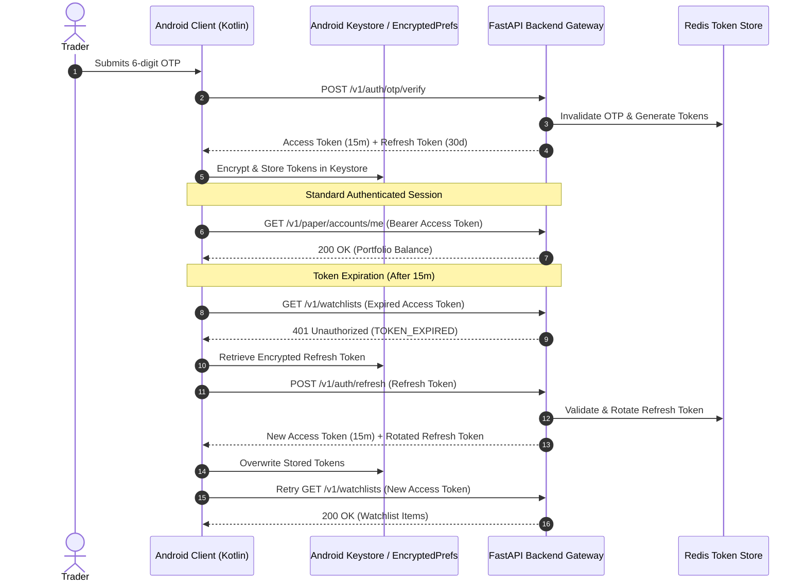
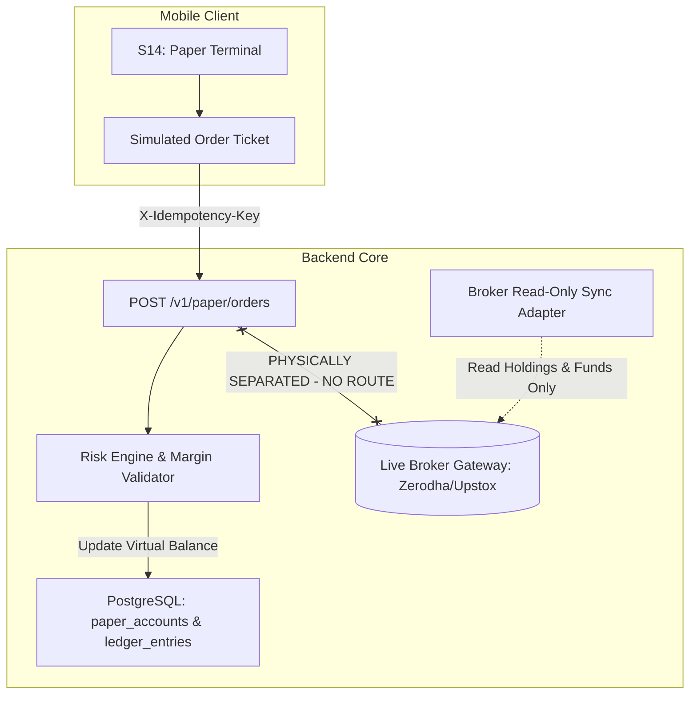

# Authentication & Security Architecture: Mobile Application
**Document:** AUTH_SECURITY.md  
**Product:** BOLD Android Trading & Research Platform  
**Target Platform:** Native Android (Kotlin, Jetpack Compose, Android 10+ / API 29+)  
**Source of Truth:** [`mobile-application/PRD.md`](file:///d:/trading%20app/mobile-application/PRD.md), [`mobile-application/ARCHITECTURE.md`](file:///d:/trading%20app/mobile-application/ARCHITECTURE.md), [`mobile-application/DATABASE.md`](file:///d:/trading%20app/mobile-application/DATABASE.md), and [`mobile-application/API.md`](file:///d:/trading%20app/mobile-application/API.md)  

---

## 1. Authentication Methods & User Flows

| Auth Method | Technology / Provider | One-Line Justification |
| :--- | :--- | :--- |
| **Passwordless SMS OTP** | **FastAPI Auth Gateway + SMS Service** | Eliminates password theft and friction for fast, mobile-first Indian market traders. |
| **Device Biometrics** | **Android BiometricPrompt API** | Hardware-backed fingerprint/face unlock without transmitting credentials over the network. |
| **Broker Read-Only OAuth** | **Provider-Approved In-App Browser** | Securely syncs account holdings while isolating broker API credentials from the mobile client. |

### 1.1 Complete Mobile Registration & Login Flow (Screens S01–S03)
1. **Phone Input:** User enters 10-digit Indian mobile number (+91) on Screen `S02`.
2. **OTP Dispatch:** Client fires `POST /v1/auth/otp/request`. Gateway generates a cryptographically random 6-digit OTP, hashes it with SHA-256 into Redis with a 120-second TTL, and dispatches via SMS.
3. **Verification:** User enters 6-digit code $\rightarrow$ Client fires `POST /v1/auth/otp/verify`.
4. **Token Generation:** Gateway validates the hash, creates user in PostgreSQL table `users` if new, and returns a short-lived Access Token and long-lived Refresh Token.
5. **Secure Storage:** Android client stores tokens inside hardware-backed `EncryptedSharedPreferences` / Jetpack DataStore using Android Keystore.
6. **Workspace Setup:** User personalizes virtual capital (₹10,00,000) and risk appetite on Screen `S03`, completing activation.

### 1.2 Biometric App Unlock Flow
1. User minimizes app or 15 minutes of inactivity elapse.
2. Upon resume, `BiometricPrompt` displays a native cryptographic authentication sheet.
3. Successful biometric scan un-encrypts the session key in Android Keystore, allowing user back into the terminal.

### 1.3 Logout & Session Clearing Flow
1. User taps **Log Out** on Screen `S20` (Profile & Security).
2. App fires `POST /v1/auth/logout` with Bearer token to blacklist the Refresh Token in Redis.
3. Client purges all stored tokens from `EncryptedSharedPreferences`, clears the Room SQLite session tables, and redirects to `S01` Splash.

---

## 2. JWT Design: Access & Refresh Tokens



### 2.1 Token Specifications
* **Access Token:**
  * **Algorithm:** RS256 (asymmetrically signed by backend private key).
  * **Lifespan:** `15 minutes`.
  * **Payload:** `sub` (User UUID), `role` (`"user"`), `exp`, `iat`, `jti`.
* **Refresh Token:**
  * **Lifespan:** `30 days`.
  * **Rotation Policy:** Single-use rotation (every `/refresh` invalidates the old token and issues a new pair).
* **Storage Location on Android:**
  * Encrypted with AES-256-GCM via `MasterKey` in **Android Keystore System** (`EncryptedSharedPreferences`). Never stored in plain SQLite, plain SharedPreferences, or static fields.

### 2.2 Transparent OkHttp Authenticator
The Android networking client implements an OkHttp `Authenticator`:
* When any network call receives a `401 Unauthorized`, OkHttp pauses execution, fires a synchronous token refresh request, updates the in-memory token, and automatically retries the original request seamlessly.

---

## 3. Physical Isolation of Paper Trading Engine

> [!CAUTION]
> **Zero Broker Execution Guarantee:** The simulated paper trading engine must NEVER possess the capability or network path to place real live orders.



1. **Independent Submodules:** Paper trading logic lives in `feature:papertrading`; broker sync logic lives in `feature:brokers`. There are zero shared dependencies or execution paths between them.
2. **Read-Only Broker Scopes:** All broker OAuth tokens request read scopes only (`read_profile`, `read_holdings`, `read_positions`). Order placement scopes are never requested.

---

## 4. Mobile Platform Security Safeguards

### 4.1 Decimal-Safe Monetary Arithmetic
* **Strict Rule:** Floating-point numbers (`Float`, `Double`) are prohibited for financial calculations.
* All currency, virtual balances, order debits, and profit/loss amounts are represented using `BigDecimal` or 64-bit integer minor paise units to eliminate floating-point drift.

### 4.2 Network Security & Cleartext Traffic Policy
* Enforced via `res/xml/network_security_config.xml`:
  ```xml
  <network-security-config>
      <base-config cleartextTrafficPermitted="false">
          <trust-anchors>
              <certificates src="system" />
          </trust-anchors>
      </base-config>
      <debug-overrides>
          <!-- Permits cleartext only for local emulator loopback (10.0.2.2) during debug -->
          <domain-config cleartextTrafficPermitted="true">
              <domain includeSubdomains="true">10.0.2.2</domain>
              <domain includeSubdomains="true">localhost</domain>
          </domain-config>
      </debug-overrides>
  </network-security-config>
  ```

### 4.3 Rate Limiting & Abuse Prevention
* **OTP Request Throttling:** Maximum 3 OTP requests per phone number per 15 minutes; 30-second cooldown between requests.
* **Order Idempotency:** Every simulated order requires a client-generated UUID `X-Idempotency-Key`. Replaying the same key returns the existing order receipt without double-debiting virtual cash.

### 4.4 Root & Tamper Protection
* The application inspects known root binaries (`/system/bin/su`, `/system/xbin/su`) and test-keys build signatures.
* On rooted devices, a non-blocking warning modal informs the user of enhanced security risks to their local cached data.

---

## 5. Pre-Launch Security Checklist (OWASP Mobile Top 10)

* [ ] **M01: Improper Credential Usage:** Verified that no API keys, OAuth secrets, or credentials exist in Android source files or decompiled APK assets.
* [ ] **M02: Inadequate Supply Chain Security:** Verified Gradle dependency checksums and version catalog provenance.
* [ ] **M03: Insecure Authentication:** Verified 15-minute access token expiry, single-use refresh token rotation, and biometric re-authentication.
* [ ] **M04: Insufficient Input/Output Validation:** Verified stop loss, target, and quantity inputs validate against tick size and positive integers before dispatch.
* [ ] **M05: Insecure Communication:** Verified `cleartextTrafficPermitted="false"` for all production release builds; TLS 1.3 enforced.
* [ ] **M06: Inadequate Privacy Controls:** Verified no Personally Identifiable Information (PII) is logged to Android Logcat in release builds.
* [ ] **M07: Insufficient Binary Protections:** Proguard / R8 code shrinking and obfuscation enabled for release builds (`minifyEnabled true`).
* [ ] **M08: Security Misconfiguration:** Verified Android Keystore backed `EncryptedSharedPreferences` for local session storage.
* [ ] **M09: Insecure Data Storage:** Verified Room SQLite database does not cache plain-text user authentication tokens.
* [ ] **M10: Insufficient Cryptography:** Verified AES-256-GCM encryption for all sensitive cached entities.
