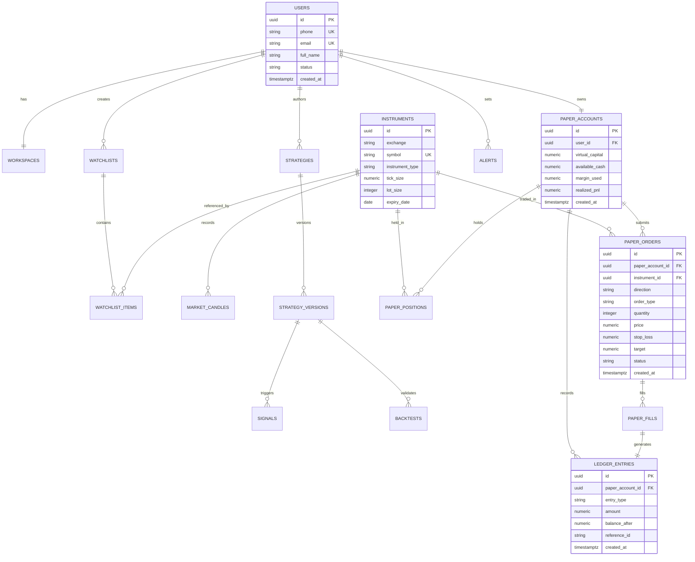

# Database Architecture & Schema Specification: Mobile Application
**Document:** DATABASE.md  
**Product:** BOLD Android Trading & Research Platform  
**Target Engines:**
1. **Server-Side Primary DB:** PostgreSQL 16+ (Normalized System of Record, Paper Ledger, Market Master)
2. **Client-Side Cache:** Android Room SQLite (Local Offline Cache & Fast Session Rendering)  
**Source of Truth:** [`mobile-application/PRD.md`](file:///d:/trading%20app/mobile-application/PRD.md), [`mobile-application/ARCHITECTURE.md`](file:///d:/trading%20app/mobile-application/ARCHITECTURE.md), and BOLD Brief Section 9

---

## 1. Architectural & Financial Data Principles

1. **Decimal-Safe Financial Arithmetic:** Floating-point data types (`FLOAT`, `REAL`, `DOUBLE`) are strictly banned for money. All monetary balances, virtual debits, prices, and profits are stored using `NUMERIC(15, 2)` or integer minor units (paise).
2. **Double-Entry Append-Only Paper Ledger:** Simulated cash movements (`ledger_entries`) are strictly append-only. Balance updates must reconcile to historical transaction entries.
3. **Immutability of Strategy Versions & Signals:** When a strategy or signal is published, its definition is immutable. Revisions increment `version_number` to preserve backtest fidelity.
4. **Timezone Standardization:** Stored in UTC (`TIMESTAMPTZ`); formatted to Indian Standard Time (`IST`, `UTC+05:30`) on the Android UI.
5. **Soft Deletions:** Custom watchlists, alerts, and strategy drafts use `deleted_at TIMESTAMPTZ NULL` for graceful recovery and auditability.

---

## 2. Server-Side Entity-Relationship (ER) Diagram (PostgreSQL)



---

## 3. Server-Side Table Schemas (PostgreSQL)

### 3.1 `users` & `workspaces`
```sql
CREATE TABLE users (
    id UUID PRIMARY KEY DEFAULT gen_random_uuid(),
    phone VARCHAR(15) NOT NULL UNIQUE,
    email VARCHAR(255) NULL UNIQUE,
    full_name VARCHAR(120) NULL,
    locale VARCHAR(10) NOT NULL DEFAULT 'en-IN',
    status VARCHAR(30) NOT NULL DEFAULT 'active' CHECK (status IN ('active', 'suspended', 'pending_otp')),
    terms_accepted_at TIMESTAMPTZ NOT NULL DEFAULT CURRENT_TIMESTAMP,
    created_at TIMESTAMPTZ NOT NULL DEFAULT CURRENT_TIMESTAMP,
    updated_at TIMESTAMPTZ NOT NULL DEFAULT CURRENT_TIMESTAMP,
    deleted_at TIMESTAMPTZ NULL
);

CREATE TABLE workspaces (
    id UUID PRIMARY KEY DEFAULT gen_random_uuid(),
    user_id UUID NOT NULL UNIQUE REFERENCES users(id) ON DELETE CASCADE,
    trading_universe VARCHAR(50) NOT NULL DEFAULT 'NSE_CASH_FNO',
    ui_density VARCHAR(20) NOT NULL DEFAULT 'intermediate' CHECK (ui_density IN ('beginner', 'intermediate', 'advanced')),
    default_chart_interval VARCHAR(10) NOT NULL DEFAULT '15m',
    risk_per_trade_percent NUMERIC(4, 2) NOT NULL DEFAULT 1.00 CHECK (risk_per_trade_percent BETWEEN 0.10 AND 10.00),
    daily_loss_limit_percent NUMERIC(4, 2) NOT NULL DEFAULT 2.00,
    created_at TIMESTAMPTZ NOT NULL DEFAULT CURRENT_TIMESTAMP,
    updated_at TIMESTAMPTZ NOT NULL DEFAULT CURRENT_TIMESTAMP
);
```

### 3.2 `instruments` & `market_candles`
```sql
CREATE TABLE instruments (
    id UUID PRIMARY KEY DEFAULT gen_random_uuid(),
    exchange VARCHAR(10) NOT NULL CHECK (exchange IN ('NSE', 'BSE', 'NFO')),
    symbol VARCHAR(50) NOT NULL, -- e.g. 'RELIANCE', 'NIFTY26NOV24800CE'
    name VARCHAR(150) NOT NULL,
    instrument_type VARCHAR(20) NOT NULL CHECK (instrument_type IN ('equity', 'index', 'future', 'option')),
    tick_size NUMERIC(8, 4) NOT NULL DEFAULT 0.0500,
    lot_size INT NOT NULL DEFAULT 1,
    strike_price NUMERIC(15, 2) NULL,
    option_type VARCHAR(4) NULL CHECK (option_type IN ('CE', 'PE')),
    expiry_date DATE NULL,
    is_active BOOLEAN NOT NULL DEFAULT true,
    created_at TIMESTAMPTZ NOT NULL DEFAULT CURRENT_TIMESTAMP,
    updated_at TIMESTAMPTZ NOT NULL DEFAULT CURRENT_TIMESTAMP,
    CONSTRAINT uq_exchange_symbol UNIQUE (exchange, symbol)
);

CREATE TABLE market_candles (
    id BIGSERIAL,
    instrument_id UUID NOT NULL REFERENCES instruments(id),
    timeframe VARCHAR(10) NOT NULL, -- '1m', '5m', '15m', '1D'
    open_price NUMERIC(15, 2) NOT NULL,
    high_price NUMERIC(15, 2) NOT NULL,
    low_price NUMERIC(15, 2) NOT NULL,
    close_price NUMERIC(15, 2) NOT NULL,
    volume BIGINT NOT NULL,
    vwap NUMERIC(15, 2) NULL,
    open_interest BIGINT NULL,
    exchange_timestamp TIMESTAMPTZ NOT NULL,
    received_timestamp TIMESTAMPTZ NOT NULL DEFAULT CURRENT_TIMESTAMP,
    PRIMARY KEY (instrument_id, timeframe, exchange_timestamp)
) PARTITION BY RANGE (exchange_timestamp);
```

### 3.3 `paper_accounts`, `paper_orders` & `ledger_entries`
```sql
CREATE TABLE paper_accounts (
    id UUID PRIMARY KEY DEFAULT gen_random_uuid(),
    user_id UUID NOT NULL UNIQUE REFERENCES users(id) ON DELETE CASCADE,
    virtual_capital NUMERIC(15, 2) NOT NULL DEFAULT 1000000.00, -- Default ₹10,00,000
    available_cash NUMERIC(15, 2) NOT NULL DEFAULT 1000000.00,
    margin_used NUMERIC(15, 2) NOT NULL DEFAULT 0.00,
    realized_pnl NUMERIC(15, 2) NOT NULL DEFAULT 0.00,
    reset_count INT NOT NULL DEFAULT 0,
    last_reset_at TIMESTAMPTZ NULL,
    created_at TIMESTAMPTZ NOT NULL DEFAULT CURRENT_TIMESTAMP,
    updated_at TIMESTAMPTZ NOT NULL DEFAULT CURRENT_TIMESTAMP
);

CREATE TABLE paper_orders (
    id UUID PRIMARY KEY DEFAULT gen_random_uuid(),
    paper_account_id UUID NOT NULL REFERENCES paper_accounts(id) ON DELETE CASCADE,
    instrument_id UUID NOT NULL REFERENCES instruments(id),
    idempotency_key VARCHAR(64) NOT NULL UNIQUE,
    direction VARCHAR(4) NOT NULL CHECK (direction IN ('BUY', 'SELL')),
    order_type VARCHAR(10) NOT NULL CHECK (order_type IN ('MARKET', 'LIMIT', 'SL', 'SL_M')),
    quantity INT NOT NULL CHECK (quantity > 0),
    requested_price NUMERIC(15, 2) NOT NULL,
    filled_price NUMERIC(15, 2) NULL,
    stop_loss NUMERIC(15, 2) NULL,
    target NUMERIC(15, 2) NULL,
    estimated_fees NUMERIC(10, 2) NOT NULL DEFAULT 0.00,
    status VARCHAR(20) NOT NULL DEFAULT 'PENDING' CHECK (status IN ('PENDING', 'FILLED', 'CANCELLED', 'REJECTED')),
    rejection_reason TEXT NULL,
    created_at TIMESTAMPTZ NOT NULL DEFAULT CURRENT_TIMESTAMP,
    updated_at TIMESTAMPTZ NOT NULL DEFAULT CURRENT_TIMESTAMP
);

CREATE TABLE paper_positions (
    id UUID PRIMARY KEY DEFAULT gen_random_uuid(),
    paper_account_id UUID NOT NULL REFERENCES paper_accounts(id) ON DELETE CASCADE,
    instrument_id UUID NOT NULL REFERENCES instruments(id),
    quantity INT NOT NULL, -- Positive for Long, Negative for Short
    average_entry_price NUMERIC(15, 2) NOT NULL,
    current_mark_price NUMERIC(15, 2) NOT NULL,
    unrealized_pnl NUMERIC(15, 2) NOT NULL DEFAULT 0.00,
    updated_at TIMESTAMPTZ NOT NULL DEFAULT CURRENT_TIMESTAMP,
    CONSTRAINT uq_account_instrument UNIQUE (paper_account_id, instrument_id)
);

CREATE TABLE ledger_entries (
    id UUID PRIMARY KEY DEFAULT gen_random_uuid(),
    paper_account_id UUID NOT NULL REFERENCES paper_accounts(id) ON DELETE CASCADE,
    order_id UUID NULL REFERENCES paper_orders(id),
    entry_type VARCHAR(30) NOT NULL CHECK (entry_type IN ('INITIAL_DEPOSIT', 'BUY_DEBIT', 'SELL_CREDIT', 'SIMULATED_FEE', 'ACCOUNT_RESET')),
    amount NUMERIC(15, 2) NOT NULL, -- Positive or negative
    balance_after NUMERIC(15, 2) NOT NULL,
    description TEXT NOT NULL,
    created_at TIMESTAMPTZ NOT NULL DEFAULT CURRENT_TIMESTAMP
);
```

### 3.4 `watchlists` & `watchlist_items`
```sql
CREATE TABLE watchlists (
    id UUID PRIMARY KEY DEFAULT gen_random_uuid(),
    user_id UUID NOT NULL REFERENCES users(id) ON DELETE CASCADE,
    name VARCHAR(60) NOT NULL,
    sort_order INT NOT NULL DEFAULT 0,
    created_at TIMESTAMPTZ NOT NULL DEFAULT CURRENT_TIMESTAMP,
    updated_at TIMESTAMPTZ NOT NULL DEFAULT CURRENT_TIMESTAMP,
    deleted_at TIMESTAMPTZ NULL
);

CREATE TABLE watchlist_items (
    id UUID PRIMARY KEY DEFAULT gen_random_uuid(),
    watchlist_id UUID NOT NULL REFERENCES watchlists(id) ON DELETE CASCADE,
    instrument_id UUID NOT NULL REFERENCES instruments(id) ON DELETE CASCADE,
    sort_order INT NOT NULL DEFAULT 0,
    created_at TIMESTAMPTZ NOT NULL DEFAULT CURRENT_TIMESTAMP,
    CONSTRAINT uq_watchlist_instrument UNIQUE (watchlist_id, instrument_id)
);
```

### 3.5 `strategies`, `signals` & `alerts`
```sql
CREATE TABLE strategies (
    id UUID PRIMARY KEY DEFAULT gen_random_uuid(),
    user_id UUID NOT NULL REFERENCES users(id) ON DELETE CASCADE,
    name VARCHAR(100) NOT NULL,
    description TEXT NULL,
    created_at TIMESTAMPTZ NOT NULL DEFAULT CURRENT_TIMESTAMP,
    updated_at TIMESTAMPTZ NOT NULL DEFAULT CURRENT_TIMESTAMP,
    deleted_at TIMESTAMPTZ NULL
);

CREATE TABLE strategy_versions (
    id UUID PRIMARY KEY DEFAULT gen_random_uuid(),
    strategy_id UUID NOT NULL REFERENCES strategies(id) ON DELETE CASCADE,
    version_number INT NOT NULL,
    timeframe VARCHAR(10) NOT NULL,
    rules_ast JSONB NOT NULL, -- Logic conditions: {"entry": [...], "exit": [...], "risk": {...}}
    status VARCHAR(20) NOT NULL DEFAULT 'DRAFT' CHECK (status IN ('DRAFT', 'VALIDATED', 'APPROVED', 'DEPRECATED')),
    created_at TIMESTAMPTZ NOT NULL DEFAULT CURRENT_TIMESTAMP,
    CONSTRAINT uq_strategy_version UNIQUE (strategy_id, version_number)
);

CREATE TABLE signals (
    id UUID PRIMARY KEY DEFAULT gen_random_uuid(),
    strategy_version_id UUID NOT NULL REFERENCES strategy_versions(id),
    instrument_id UUID NOT NULL REFERENCES instruments(id),
    direction VARCHAR(4) NOT NULL CHECK (direction IN ('BUY', 'SELL')),
    timeframe VARCHAR(10) NOT NULL,
    entry_zone_min NUMERIC(15, 2) NOT NULL,
    entry_zone_max NUMERIC(15, 2) NOT NULL,
    stop_loss NUMERIC(15, 2) NOT NULL,
    target_1 NUMERIC(15, 2) NOT NULL,
    target_2 NUMERIC(15, 2) NULL,
    target_3 NUMERIC(15, 2) NULL,
    status VARCHAR(20) NOT NULL DEFAULT 'ACTIVE' CHECK (status IN ('NEW', 'ACTIVE', 'INVALIDATED', 'EXPIRED', 'FILLED')),
    triggered_at TIMESTAMPTZ NOT NULL DEFAULT CURRENT_TIMESTAMP,
    valid_until TIMESTAMPTZ NOT NULL
);

CREATE TABLE alerts (
    id UUID PRIMARY KEY DEFAULT gen_random_uuid(),
    user_id UUID NOT NULL REFERENCES users(id) ON DELETE CASCADE,
    instrument_id UUID NOT NULL REFERENCES instruments(id),
    condition_type VARCHAR(30) NOT NULL CHECK (condition_type IN ('PRICE_ABOVE', 'PRICE_BELOW', 'VOLUME_SPIKE', 'RISK_USAGE')),
    threshold_value NUMERIC(15, 2) NOT NULL,
    is_active BOOLEAN NOT NULL DEFAULT true,
    triggered_at TIMESTAMPTZ NULL,
    created_at TIMESTAMPTZ NOT NULL DEFAULT CURRENT_TIMESTAMP,
    updated_at TIMESTAMPTZ NOT NULL DEFAULT CURRENT_TIMESTAMP,
    deleted_at TIMESTAMPTZ NULL
);
```

---

## 4. Client-Side Local Database Schema (Android Room SQLite)

To enable 60 FPS scrolling and instant offline launches without hitting API rate limits, the Android app maintains an embedded Room cache:

```kotlin
// 1. Cached Instrument Reference
@Entity(tableName = "cached_instruments")
data class CachedInstrumentEntity(
    @PrimaryKey val id: String,
    val exchange: String,
    val symbol: String,
    val name: String,
    val tickSize: Double,
    val lotSize: Int,
    val lastTradedPrice: Double,
    val changePercent: Double,
    val lastUpdated: Long
)

// 2. Cached Watchlist Row
@Entity(tableName = "cached_watchlist_items", primaryKeys = ["watchlistId", "instrumentId"])
data class CachedWatchlistItemEntity(
    val watchlistId: String,
    val instrumentId: String,
    val symbol: String,
    val sortOrder: Int
)

// 3. Cached Offline Paper Positions
@Entity(tableName = "cached_paper_positions")
data class CachedPaperPositionEntity(
    @PrimaryKey val instrumentId: String,
    val symbol: String,
    val quantity: Int,
    val avgEntryPrice: Double,
    val currentLtp: Double,
    val unrealizedPnl: Double
)

// 4. Offline Trade Journal
@Entity(tableName = "offline_trade_journal")
data class OfflineTradeJournalEntity(
    @PrimaryKey val id: String,
    val symbol: String,
    val pnlAmount: Double,
    val processRating: Int, // 1 to 5 stars
    val notes: String,
    val tags: String, // Comma-separated: "#VWAP,#Disciplined"
    val timestamp: Long
)
```

---

## 5. Indexes for High-Frequency Queries

```sql
-- Fast Watchlist queries per user
CREATE INDEX idx_watchlists_user ON watchlists(user_id) WHERE deleted_at IS NULL;
CREATE INDEX idx_watchlist_items_wid ON watchlist_items(watchlist_id, sort_order);

-- Real-time quote lookup & search
CREATE INDEX idx_instruments_search ON instruments(exchange, symbol) WHERE is_active = true;

-- Paper orders and position lookups
CREATE INDEX idx_paper_orders_account_status ON paper_orders(paper_account_id, status);
CREATE INDEX idx_ledger_account_created ON ledger_entries(paper_account_id, created_at DESC);

-- Real-time active signal lookups
CREATE INDEX idx_signals_active ON signals(status, valid_until) WHERE status = 'ACTIVE';

-- User alerts checking
CREATE INDEX idx_alerts_instrument_active ON alerts(instrument_id, condition_type) WHERE is_active = true AND deleted_at IS NULL;
```

---

## 6. Row-Level Security (RLS) & Access Rules

```sql
-- Enable RLS across user-owned tables
ALTER TABLE workspaces ENABLE ROW LEVEL SECURITY;
ALTER TABLE paper_accounts ENABLE ROW LEVEL SECURITY;
ALTER TABLE paper_orders ENABLE ROW LEVEL SECURITY;
ALTER TABLE ledger_entries ENABLE ROW LEVEL SECURITY;
ALTER TABLE watchlists ENABLE ROW LEVEL SECURITY;
ALTER TABLE alerts ENABLE ROW LEVEL SECURITY;

-- Policy: Users can only select/update their own workspace
CREATE POLICY p_workspaces_owner ON workspaces
    FOR ALL
    USING (user_id = auth.uid());

-- Policy: Users can only see and execute against their own paper account
CREATE POLICY p_paper_account_owner ON paper_accounts
    FOR ALL
    USING (user_id = auth.uid());

-- Policy: Users can only access their own watchlists and alerts
CREATE POLICY p_watchlists_owner ON watchlists
    FOR ALL
    USING (user_id = auth.uid());

CREATE POLICY p_alerts_owner ON alerts
    FOR ALL
    USING (user_id = auth.uid());
```

---

## 7. Migration Order & Sample Seed Data

### 7.1 Migration Order
1. `001_create_users_and_workspaces.sql`
2. `002_create_instruments_and_candles.sql`
3. `003_create_paper_ledger_and_orders.sql`
4. `004_create_watchlists.sql`
5. `005_create_strategies_and_signals.sql`
6. `006_create_alerts.sql`
7. `007_create_indexes_and_rls.sql`

### 7.2 Sample Seed Data

```sql
-- Seed Liquid NSE Core Instruments
INSERT INTO instruments (id, exchange, symbol, name, instrument_type, tick_size, lot_size) VALUES
('b0000000-0000-0000-0000-000000000001', 'NSE', 'RELIANCE', 'Reliance Industries Ltd.', 'equity', 0.0500, 1),
('b0000000-0000-0000-0000-000000000002', 'NSE', 'HDFCBANK', 'HDFC Bank Ltd.', 'equity', 0.0500, 1),
('b0000000-0000-0000-0000-000000000003', 'NSE', 'INFY', 'Infosys Ltd.', 'equity', 0.0500, 1),
('b0000000-0000-0000-0000-000000000004', 'NSE', 'TCS', 'Tata Consultancy Services Ltd.', 'equity', 0.0500, 1);

-- Seed Demo User & Free Workspace
INSERT INTO users (id, phone, email, full_name, status) VALUES
('c0000000-0000-0000-0000-000000000001', '+919876543210', 'aarav.shah@example.com', 'Aarav Shah', 'active');

INSERT INTO workspaces (user_id, trading_universe, ui_density, risk_per_trade_percent, daily_loss_limit_percent) VALUES
('c0000000-0000-0000-0000-000000000001', 'NSE_CASH_FNO', 'intermediate', 1.00, 2.00);

-- Initialize Virtual Account with ₹10,00,000 Starting Capital
INSERT INTO paper_accounts (id, user_id, virtual_capital, available_cash, margin_used, realized_pnl) VALUES
('d0000000-0000-0000-0000-000000000001', 'c0000000-0000-0000-0000-000000000001', 1000000.00, 800000.00, 120000.00, 42680.00);

INSERT INTO ledger_entries (paper_account_id, entry_type, amount, balance_after, description) VALUES
('d0000000-0000-0000-0000-000000000001', 'INITIAL_DEPOSIT', 1000000.00, 1000000.00, 'Initial virtual demo capital allocation');
```
