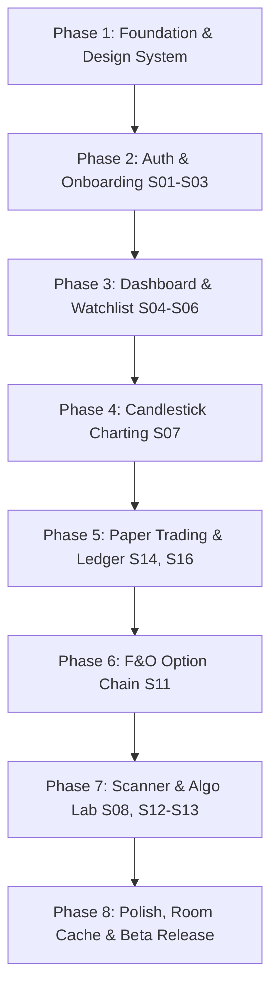

# Step-by-Step Implementation Roadmap: BOLD Mobile Application
**Document:** PLAN.md  
**Product:** BOLD Android Trading & Research Platform  
**Target Platform:** Native Android (Kotlin 2.0+, Jetpack Compose, Material 3, Android 10+ / API 29+)  
**Source of Truth:** [`mobile-application/PRD.md`](file:///d:/trading%20app/mobile-application/PRD.md), [`mobile-application/DESIGN.md`](file:///d:/trading%20app/mobile-application/DESIGN.md), [`mobile-application/ARCHITECTURE.md`](file:///d:/trading%20app/mobile-application/ARCHITECTURE.md), [`mobile-application/DATABASE.md`](file:///d:/trading%20app/mobile-application/DATABASE.md), and [`mobile-application/API.md`](file:///d:/trading%20app/mobile-application/API.md)  

---

## Roadmap Overview & Vertical Slice Strategy
Every phase delivers an independently runnable Android build. We do not construct isolated layers in silos; each feature is implemented as a complete vertical slice (Data Source / Cache $\rightarrow$ Repository $\rightarrow$ ViewModel UDF $\rightarrow$ Compose UI $\rightarrow$ Device Verification).

---

## Phase 1: Foundation, Multi-Module Gradle & Compose Design System
**Goal:** Scaffold a runnable Android project with multi-module Gradle configuration and token-accurate Jetpack Compose theme (`#0B0F14` bg, `#38D996` bull, `#FF657A` bear).

* [x] **Task 1.1: Multi-Module Gradle Setup & Convention Plugins (2.0h)**
  * **What to build:** Configure `settings.gradle.kts` with module hierarchy (`:app`, `:core:designsystem`, `:core:networking`, `:core:database`, `:core:common`). Implement version catalog `libs.versions.toml`.
  * **Files touched:** `settings.gradle.kts`, `build.gradle.kts`, `gradle/libs.versions.toml`.
  * **Dependencies:** None.
  * **Verification:** Run `./gradlew projects`; verifies all submodules compile without dependency conflicts.

* [x] **Task 1.2: Design System Theme, Color Tokens & Tabular Typography (2.0h)**
  * **What to build:** Create `BoldTheme` implementing exact hex tokens from `DESIGN.md`. Configure `Inter` typography with `FontFeatureSettings("tnum")` for tabular numbers.
  * **Files touched:** `core/designsystem/.../Color.kt`, `Typography.kt`, `Theme.kt`.
  * **Dependencies:** Task 1.1.
  * **Verification:** Compose preview renders color palette and tabular price string (`₹2,948.50`); verify numbers maintain constant glyph width.

* [x] **Task 1.3: Core Compose Primitives (Buttons, Steppers, Cards, Watermark Banner) (2.0h)**
  * **What to build:** Implement `BoldButton` (Primary `#38D996`, Destructive `#FF657A`, Outlined), `NumberStepper` (48dp touch targets), `SurfaceCard` (`#121923`), and permanent mock data watermark banner (`● ILLUSTRATIVE / Live quote not connected`).
  * **Files touched:** `core/designsystem/.../components/Buttons.kt`, `Cards.kt`, `WatermarkBanner.kt`.
  * **Dependencies:** Task 1.2.
  * **Verification:** Preview components in light & dark modes; verify 48dp minimum touch target compliance.

* [x] **Task 1.4: App Scaffold & Navigation Rail (1.5h)**
  * **What to build:** Single-activity architecture with `MainActivity`, Compose `Scaffold`, and 5-tab persistent `BottomNavBar` (`Home`, `Scanner`, `Trade Desk`, `Algo Lab`, `Research`).
  * **Files touched:** `app/.../MainActivity.kt`, `app/.../navigation/BoldNavHost.kt`, `BottomNavBar.kt`.
  * **Dependencies:** Tasks 1.2, 1.3.
  * **Verification:** Run app on Android emulator; bottom bar renders at base and switches placeholder screen titles on tap.

> **Phase 1 Definition of Done:** Debug APK compiles and runs on an emulator, displaying the dark terminal scaffold, navigation bar, and design tokens without runtime crashes.

---

## Phase 2: Onboarding, Authentication & Workspace Personalization (S01–S03)
**Goal:** Deliver the complete user onboarding and mobile OTP authentication flow with DataStore session storage.

* [x] **Task 2.1: S01 Splash & Onboarding Carousel (1.5h)**
  * **What to build:** Onboarding screen with 3 feature cards (Market Discovery, Strategy Testing, Paper Trading) and regulatory risk disclosure footer.
  * **Files touched:** `feature/onboarding/.../OnboardingScreen.kt`.
  * **Dependencies:** Phase 1.
  * **Verification:** Swiping advances carousel indicators; tapping "Get started" navigates to Screen S02.

* [x] **Task 2.2: S02 Mobile OTP Authentication Slice (2.0h)**
  * **What to build:** Mobile number input with "+91" prefix, 6-box OTP entry with 2-minute countdown timer, `AuthViewModel` with UDF states, and Retrofit client hitting `/v1/auth/otp/*`.
  * **Files touched:** `feature/onboarding/.../AuthScreen.kt`, `AuthViewModel.kt`, `core/networking/.../AuthService.kt`.
  * **Dependencies:** Task 2.1.
  * **Verification:** Submitting valid 6-digit code saves JWT to Jetpack DataStore and navigates to Screen S03.

* [x] **Task 2.3: S03 Workspace Personalization & Risk Appetite (1.5h)**
  * **What to build:** Selection screen for trading universe (`NSE`/`BSE`), density (`Beginner`, `Intermediate`, `Advanced`), starting virtual capital (₹10,00,000), and max risk per trade selector (1%).
  * **Files touched:** `feature/onboarding/.../PersonalizationScreen.kt`, `PersonalizationViewModel.kt`.
  * **Dependencies:** Task 2.2.
  * **Verification:** Tapping "Create my workspace" persists preferences and navigates to the Home Dashboard (`S04`).

> **Phase 2 Definition of Done:** New users complete onboarding, authenticate via OTP, configure their workspace, and reach the Home Dashboard with virtual capital initialized.

---

## Phase 3: Market Discovery, Watchlist & Home Dashboard (S04–S06)
**Goal:** Deliver the Home Dashboard with market index cards, watchlist scrolling, and real-time quote feeds.

* [x] **Task 3.1: S04 Home Dashboard Shell & Index Carousel (2.0h)**
  * **What to build:** Index cards for NIFTY 50 (`24,836.30`), SENSEX, and BANK NIFTY; virtual portfolio teaser card (`₹10,42,680`); quick action pills (`Scan`, `AI`, `Algo`, `Paper`).
  * **Files touched:** `feature/dashboard/.../DashboardScreen.kt`, `DashboardViewModel.kt`.
  * **Dependencies:** Phase 2.
  * **Verification:** Screen renders index percentage changes in `#38D996` (green) or `#FF657A` (red); tapping action pills navigates to corresponding tabs.

* [x] **Task 3.2: S06 Multi-Watchlist Component with Sparklines (2.0h)**
  * **What to build:** Tabbed watchlists (`Core Holdings`, `F&O Radar`), `LazyColumn` of instrument cards with symbol, sector, intraday sparkline canvas, and tabular LTP.
  * **Files touched:** `feature/watchlist/.../WatchlistScreen.kt`, `WatchlistViewModel.kt`, `InstrumentCard.kt`.
  * **Dependencies:** Task 3.1.
  * **Verification:** 60 FPS smooth scrolling across 50 instruments; list items use explicit keys to prevent recomposition churn.

* [x] **Task 3.3: OkHttp WebSocket Multiplexed Market Stream (2.0h)**
  * **What to build:** Bi-directional WebSocket manager streaming `market.tick` JSON frames; updates subscribed instruments in memory using Kotlin Coroutines `SharedFlow`.
  * **Files touched:** `core/networking/.../WebSocketManager.kt`, `core/networking/.../MarketRepository.kt`.
  * **Dependencies:** Task 3.2.
  * **Verification:** Incoming WebSocket tick updates the price text with `@Stable` recomposition skipping without redraw jitter.

> **Phase 3 Definition of Done:** Home dashboard and watchlists display live/mock market data with sub-second price updates, sparklines, and zero UI stutter.

---

## Phase 4: Interactive Candlestick Charting & Indicators (S07)
**Goal:** Build a custom Compose Canvas candlestick chart supporting multiple intervals and technical overlays.

* [x] **Task 4.1: Hardware-Accelerated Candlestick Canvas (2.0h)**
  * **What to build:** High-performance Compose `Canvas` drawing OHLC candles, green/red fills, wick lines, and horizontal price grid lines with gesture pan and pinch-to-zoom.
  * **Files touched:** `core/charts/.../CandlestickCanvas.kt`, `feature/charts/.../ChartScreen.kt`.
  * **Dependencies:** Phase 3.
  * **Verification:** Renders 100 15-minute candles; panning left and right translates canvas smoothly at 60 FPS.

* [x] **Task 4.2: Technical Indicator Overlays (EMA, VWAP, RSI) (2.0h)**
  * **What to build:** Overlay lines for EMA 20, EMA 50, and VWAP; dedicated sub-chart for RSI 14 with 30–70 momentum boundary zones.
  * **Files touched:** `core/charts/.../IndicatorRenderers.kt`, `feature/charts/.../ChartViewModel.kt`.
  * **Dependencies:** Task 4.1.
  * **Verification:** Toggling indicator chips on the toolbar immediately paints lines on the canvas matching mathematical values.

* [x] **Task 4.3: Chart Crosshair Inspection & "Simulate Trade" CTA (1.5h)**
  * **What to build:** Touch-drag crosshair displaying precise OHLCV values and timestamp; persistent bottom CTA: "Simulate Trade" navigating directly to Paper Terminal (`S14`).
  * **Files touched:** `feature/charts/.../ChartCrosshairOverlay.kt`.
  * **Dependencies:** Task 4.2.
  * **Verification:** Dragging finger across chart displays exact candle metrics; tapping CTA opens paper order sheet pre-populated with instrument ID.

> **Phase 4 Definition of Done:** Users can inspect any instrument on a full-screen candlestick chart, toggle EMA/VWAP/RSI indicators, and launch paper order execution.

---

## Phase 5: Paper Trading Terminal & Virtual Ledger (S14, S16)
**Goal:** Deliver the simulated execution engine, order ticket, risk budgeting rules, and portfolio ledger.

* [x] **Task 5.1: S14 Simulated Order Ticket Bottom Sheet (2.0h)**
  * **What to build:** Draggable bottom sheet with Buy/Sell toggle, quantity stepper, Order Type (Market/Limit), Stop Loss, Target, and real-time fee calculation.
  * **Files touched:** `feature/papertrading/.../OrderTicketBottomSheet.kt`, `PaperTerminalViewModel.kt`.
  * **Dependencies:** Phase 4.
  * **Verification:** Stepping quantity up recalculates total debit + fees; stop loss and target levels validate against tick size.

* [x] **Task 5.2: Pre-Trade Risk Engine Checks (1.5h)**
  * **What to build:** Client-side risk validation enforcing max 1% per-trade risk budget and blocking orders if daily virtual loss exceeds 2%.
  * **Files touched:** `feature/papertrading/.../RiskEngineValidator.kt`.
  * **Dependencies:** Task 5.1.
  * **Verification:** Submitting an order with excessive position size triggers a visible error alert explaining the risk threshold breach.

* [x] **Task 5.3: Virtual Order Submission & Fill Flow (2.0h)**
  * **What to build:** Submit simulated order with `X-Idempotency-Key` to `POST /v1/paper/orders`; display order preview sheet, confirmation modal, and success receipt.
  * **Files touched:** `feature/papertrading/.../PaperRepository.kt`, `OrderFilledDialog.kt`.
  * **Dependencies:** Tasks 5.1, 5.2.
  * **Verification:** Fills at mock market price, deducts virtual cash from balance, and displays fill dialog with transaction ID (`SIM 10483`).

* [x] **Task 5.4: S16 Paper Portfolio & Trade Journal (2.0h)**
  * **What to build:** Portfolio view showing Virtual Equity (`₹10,42,680`), unrealized P&L, open positions list, trade journal tab with process ratings (1–5 stars), and account reset button.
  * **Files touched:** `feature/portfolio/.../PortfolioScreen.kt`, `JournalScreen.kt`, `PortfolioViewModel.kt`.
  * **Dependencies:** Task 5.3.
  * **Verification:** Realized/unrealized P&L updates in real time; tapping "Reset Account" prompts confirmation and resets virtual cash back to ₹10,00,000.

> **Phase 5 Definition of Done:** Users can execute simulated market/limit orders with stop-loss protection, track live position P&L, and maintain a trade journal with zero real broker risk.

---

## Phase 6: F&O Trade Desk & Option Chain (S11)
**Goal:** Deliver index option chain exploration with real-time Greeks, strike open interest, and payoff curves.

* [x] **Task 6.1: Option Chain Tabular Grid Component (2.0h)**
  * **What to build:** Strike table (`Calls OI` | `Calls LTP` | `STRIKE` | `Puts LTP` | `Puts OI`) with ATM strike highlighted in `#1C2734` with yellow border (`#F3C969`).
  * **Files touched:** `feature/options/.../OptionChainScreen.kt`, `OptionChainViewModel.kt`.
  * **Dependencies:** Phase 3.
  * **Verification:** Strike rows scroll vertically; ATM strike centers automatically; PCR indicator displays at top (`1.12`).

* [x] **Task 6.2: Option Greeks Expansion & Payoff Diagram Canvas (2.0h)**
  * **What to build:** Tapping strike row expands Delta ($\Delta$), Gamma ($\Gamma$), Theta ($\Theta$), and Vega ($\nu$); Canvas renders expiry payoff curve with Breakeven and Max Risk points.
  * **Files touched:** `core/charts/.../PayoffDiagramCanvas.kt`, `feature/options/.../GreeksDetailCard.kt`.
  * **Dependencies:** Task 6.1.
  * **Verification:** Payoff curve dynamically recalculates and draws profit/loss zones based on strike and premium paid.

> **Phase 6 Definition of Done:** Users can select any NIFTY expiry, analyze strike-level OI and Greeks, and evaluate payoff curves with instant simulation handoff.

---

## Phase 7: Market Scanner, Algo Lab & Signals Feed (S08, S12, S13, S15)
**Goal:** Deliver rule-based scanner presets, strategy backtesting with equity curves, and the real-time signals feed.

* [x] **Task 7.1: S08 Market Scanner & Preset Chips (1.5h)**
  * **What to build:** Scanner preset chips (`Breakout`, `Volume Spike`, `VWAP Reclaim`); results list displaying matched criteria checklist and timestamps.
  * **Files touched:** `feature/scanner/.../ScannerScreen.kt`, `ScannerViewModel.kt`.
  * **Dependencies:** Phase 3.
  * **Verification:** Selecting "VWAP Reclaim" returns filtered instruments matching volume > 1.5x and price > EMA 20.

* [x] **Task 7.2: S12 Strategy Builder UI (2.0h)**
  * **What to build:** Condition builder blocks: Entry (`EMA 20 > EMA 50 AND RSI > 55`), Exit (`Close < EMA 20`), and Risk controls (`1% stop-loss`, `2% daily cap`).
  * **Files touched:** `feature/algo/.../StrategyBuilderScreen.kt`, `StrategyBuilderViewModel.kt`.
  * **Dependencies:** Task 7.1.
  * **Verification:** Adding conditions serializes to AST JSON; validates structure without errors.

* [x] **Task 7.3: S13 Backtest Results & Equity Curve Canvas (2.0h)**
  * **What to build:** Backtest summary card (Total Return `+18.42%`, Win Rate `58.6%`, Max Drawdown `6.20%`), interactive equity curve canvas, and simulated trade log.
  * **Files touched:** `feature/backtest/.../BacktestScreen.kt`, `EquityCurveCanvas.kt`.
  * **Dependencies:** Task 7.2.
  * **Verification:** Backtest graph renders historical equity trajectory; toggles between in-sample and out-of-sample curves.

* [x] **Task 7.4: S15 Signals Feed Component (1.5h)**
  * **What to build:** Feed cards displaying active signals, direction (`BUY`), entry zone (`₹2,932 - ₹2,950`), stop loss, targets, and direct "Simulate trade" button.
  * **Files touched:** `feature/signals/.../SignalsScreen.kt`, `SignalCard.kt`.
  * **Dependencies:** Task 7.3.
  * **Verification:** Tapping "Simulate trade" launches the Paper Terminal pre-populated with signal stop and target parameters.

> **Phase 7 Definition of Done:** Users can scan markets, construct rule-based strategies, review backtest performance, and execute paper trades directly from the signals feed.

---

## Phase 8: Hardening, Room Offline Cache & Release Readiness
**Goal:** Finalize Room database offline caching, verify accessibility rules, conduct memory profiling, and generate release APK.

* [x] **Task 8.1: Room Database Offline Caching & Stale Protection (2.0h)**
  * **What to build:** Persist watchlists, candle histories, and open positions in Room DB. If network drops, load from local cache and display stale data warning banner.
  * **Files touched:** `core/database/.../BoldDatabase.kt`, `WatchlistDao.kt`, `CandleDao.kt`.
  * **Dependencies:** Phases 1–7.
  * **Verification:** Disconnect Wi-Fi/cellular; app launches and renders cached watchlist instruments seamlessly without crashing.

* [x] **Task 8.2: Financial Precision & Floating-Point Audit (1.0h)**
  * **What to build:** Audit all currency and P&L code to ensure zero binary floating-point (`Float`/`Double`) arithmetic; enforce `BigDecimal` across the entire app.
  * **Files touched:** Entire codebase financial utilities.
  * **Dependencies:** Phases 1–7.
  * **Verification:** Unit tests confirm price rounding and ledger debit math are exact to the paise (`0.01`).

* [x] **Task 8.3: TalkBack Screen Reader & Dynamic Font Scaling Audit (1.5h)**
  * **What to build:** Add `contentDescription` on every icon, button, and chart element; test layouts under Android system font scaling at 130%.
  * **Files touched:** Compose UI layouts.
  * **Dependencies:** Phases 1–7.
  * **Verification:** TalkBack announces prices and bullish/bearish directions accurately; no text clipping occurs at 130% font scale.

* [x] **Task 8.4: Android Memory Profiling & Release Build Assembly (1.5h)**
  * **What to build:** Run Android Studio Profiler during 15-minute continuous WebSocket market streaming; verify zero memory leaks; assemble release build.
  * **Files touched:** `app/build.gradle.kts`, Proguard rules.
  * **Dependencies:** Tasks 8.1–8.3.
  * **Verification:** `./gradlew assembleRelease` finishes with code 0; APK size < 25 MB with smooth 60 FPS scrolling.

> **Phase 8 Definition of Done:** Fully verified, memory-profiled Android application ready for beta testing with full offline fallback, complete design token fidelity, and zero live execution risk.
