# Product Requirements Document (PRD)
## BOLD Mobile Application (Android)
**Version:** 1.0  
**Status:** Ready for Review  
**Target Platform:** Android (Jetpack Compose, Kotlin)  
**Parent Specification:** BOLD UI/UX Design Brief & Screen Layout v1.0  
**Commercial Model (Launch):** 100% Free Access (All features unlocked, zero subscription paywalls at launch)

---

## 1. Problem Statement & Target Users

### 1.1 Problem Statement
Retail traders and systematic market researchers in Indian capital markets (NSE & BSE) are underserved by current mobile offerings:
1. **Gamified, Casino-Style Interfaces:** Mainstream retail apps prioritize impulsive order placement rather than disciplined, risk-managed research.
2. **Fragmented Workflow:** Traders must toggle between charting software (TradingView), screeners, spreadsheet journals, and paper trading websites.
3. **High Capital Risk for Beginners & Systematic Traders:** Testing new options strategies or algorithmic conditions with real capital often leads to severe drawdowns due to lack of realistic simulated execution (accounting for slippage, statutory fees, and disciplined stop-loss rules).

**BOLD Mobile** provides an institutional-grade, dark-themed research, algorithmic strategy validation, and simulated paper-trading platform designed specifically for Indian equities, indices, and derivatives. At initial launch, **every single feature is free** to maximize adoption and validate algorithmic signals safely.

---

### 1.2 Target User Personas

#### Persona 1: The Systematic Day & Swing Trader (Aarav, 29)
* **Background:** Software engineer trading NIFTY 50 and high-beta liquid equities during market hours.
* **Pain Points:** Wants indicator-based rule validation (e.g., VWAP reclaim, EMA crossovers) without staring at charts all day. Tired of losing money testing unproven setups.
* **Goals:** Create structured rules, receive clean signals with explicit entry/invalidation zones, and test them with virtual capital before risking money.

#### Persona 2: The F&O Derivatives Trader (Priya, 35)
* **Background:** Active index options trader (NIFTY, BANK NIFTY) with 3+ years experience.
* **Pain Points:** Standard broker option chains are slow, lack real-time Greeks, and don't provide instant payoff diagrams or strike-level OI visualization on mobile.
* **Goals:** Explore strike-level OI changes, PCR, Greeks ($\Delta$, $\Gamma$, $\Theta$, $\nu$), and test multi-leg option strategies in a paper terminal without margin blowups.

#### Persona 3: The Learning & Disciplined Novice (Rohan, 24)
* **Background:** Recent college graduate interested in financial markets; overwhelmed by technical jargon and fake "financial guru" tips.
* **Pain Points:** Afraid of blowing up initial savings. Doesn't understand how slippage, taxes, and fees erode capital.
* **Goals:** Learn market structure with ₹10,00,000 in virtual capital, verify AI-summarized quarterly filings, and track process discipline via an automated trade journal.

---

## 2. Goals and Non-Goals

### 2.1 Product Goals
* **Institutional-Grade Dark Terminal:** Clean, high-density, professional mobile UI (8dp grid, tabular figures, high contrast `#0B0F14` / `#121923` palette) adhering to Screens `S01`–`S20`.
* **Realistic Paper Execution Ledger:** Double-entry virtual accounting modeling market/limit orders, slippage, and brokerage fees.
* **Disciplined Risk Engine:** Hard per-trade risk budgets (0.5%–2%) and daily loss stop guards with kill switch functionality.
* **Visual Strategy & Scanner Engine:** Multi-timeframe condition builder (EMA, RSI, Volume, F&O OI change) with historical backtesting.
* **100% Free Launch Model:** Complete feature set unlocked for all registered users without credit card requirements or paywalls.
* **Separation of Concerns:** Clear demarcation between mock/delayed feeds and live data ("Live quote not connected / Illustrative").

### 2.2 Non-Goals (Explicitly Out of Scope for Launch)
* **NO LIVE ORDER PLACEMENT:** The mobile app will **never** transmit orders to real broker exchange gateways in V1. Broker integrations are strictly read-only for portfolio and holdings synchronization.
* **No Payment Gateway / Subscriptions:** No Razorpay/Stripe or Google In-App Purchases at launch. All "Pro/Premium" capabilities are unlocked globally via configuration.
* **No Guaranteed Returns / Stock Tips:** BOLD is a research tool, not a SEBI-registered advisory tip service. All signals display rationale and invalidation zones, never promises of profit.
* **No iOS / Web App (in this phase):** Focused exclusively on native Android (Kotlin + Compose).

---

## 3. Core Features Split: MVP, V2, and Later

```mermaid
flowchart LR
    subgraph MVP ["MVP (Must-Have: Weeks 1-8)"]
        F1["S01-S03: Auth & Setup"]
        F2["S04-S06: Dashboard & Watchlist"]
        F3["S07: Advanced Charts"]
        F4["S14, S16: Paper Terminal & Ledger"]
    end
    subgraph V2 ["V2 (Should-Have: Weeks 9-16)"]
        F5["S08: Scanner Presets"]
        F6["S11: Options Desk & Greeks"]
        F7["S12-S13: Strategy Builder & Backtest"]
        F8["S15: Real-time Signals"]
        F9["S18: Push Alerts"]
    end
    subgraph Later ["Later (Nice-to-Have: Weeks 17+)"]
        F10["S10: AI Research Assistant (RAG)"]
        F11["S17: Broker Read-Sync Hub"]
        F12["S19: Monetization / Paywalls"]
        F13["Localization (Hindi)"]
    end
    MVP --> V2 --> Later
```

### 3.1 MVP (Must-Have — Shippable Core)
| Screen | Feature | Description |
| :--- | :--- | :--- |
| **S01–S02** | **Onboarding & Auth** | Splash screen, mobile OTP verification, session management, risk disclosure. |
| **S03** | **Personalization** | Select default trading universe (NSE/BSE, Cash/F&O), starting virtual capital (₹10,00,000 default), and risk appetite. |
| **S04** | **Home Dashboard** | Market status banner, NIFTY 50 / SENSEX / BANK NIFTY indices, top movers, virtual equity card, quick action pills. |
| **S06** | **Watchlist & Details** | Custom named watchlists, quote cards, intraday sparklines, fundamental statistics, and quick buy/sell action triggers. |
| **S07** | **Interactive Charting** | Candlestick & line charts (1m, 5m, 15m, 1D), EMA (20/50), VWAP, RSI (14), MACD, volume bars, zoom/pan. |
| **S14** | **Paper Trading Terminal** | Simulated order entry (Market/Limit), quantity calculator, Stop-Loss / Target input, order preview sheet, position tracking. |
| **S16** | **Portfolio & Journal** | Virtual equity balance, unrealized/realized P&L, position cards, reset account button with audit log. |
| **Global** | **Data Integrity Guard** | Prominent "ILLUSTRATIVE / Live quote not connected" banner across all screens when running mock/delayed data. |

### 3.2 V2 (Should-Have — Advanced Terminal Experience)
| Screen | Feature | Description |
| :--- | :--- | :--- |
| **S05** | **Market Overview & Heatmap** | Sector heatmap, market breadth (Advances/Declines), volume shockers, gap-up/down scanners. |
| **S08** | **Market Scanner** | Pre-built scans (Breakout, Breakdown, VWAP Reclaim, Volume Spike), custom AND/OR filter builder. |
| **S11** | **F&O Trade Desk** | Option Chain (Calls/Puts, Strike, LTP, OI, OI Change, IV, $\Delta$, $\Gamma$, $\Theta$, $\nu$), strike payoff graph. |
| **S12–S13**| **Strategy Builder & Backtest** | No-code rule builder, historical backtest engine with equity curves, win rate, max drawdown, and modelled slippage/taxes. |
| **S15** | **Signals Feed** | Real-time scanner signals with entry zones, target levels, and invalidation criteria. |
| **S18** | **Alerts & Notifications** | Price breach, volume spike, and risk limit reach notifications via Firebase Cloud Messaging. |

### 3.3 Later (Nice-to-Have — Intelligence & Ecosystem)
| Screen | Feature | Description |
| :--- | :--- | :--- |
| **S10** | **AI Research Assistant** | Natural-language query interface returning sourced summaries from company filings and earnings commentary with citations. |
| **S09** | **Fundamentals & Peers** | Quarterly financials, valuation ratios (P/E, P/B, EV/EBITDA), debt-to-equity, peer comparison tables. |
| **S17** | **Broker Sync Hub** | OAuth login to Zerodha Kite, Upstox, Angel One to import holdings and cash balances in read-only mode. |
| **S19** | **Subscription & Billing** | Activation of Pro/Premium tiers once monetization is enabled. |
| **i18n** | **Localization** | Multi-language support starting with Hindi. |

---

## 4. User Stories

### Onboarding & Security
* **US01:** *As a new user*, I want to sign up using my mobile number and a 6-digit OTP, *so that* I have a secure account without needing to remember complex passwords.
* **US02:** *As a novice trader*, I want to select my starting virtual capital (e.g., ₹10,00,000) and risk preference during onboarding, *so that* my workspace is tailored to my experience level.

### Market Discovery & Charts
* **US03:** *As a technical trader*, I want to search any NSE stock and view its 15-minute candlestick chart with VWAP and EMA 20/50, *so that* I can evaluate price action quickly on mobile.
* **US04:** *As a swing trader*, I want to organize stocks into custom watchlists (e.g., "Core Holdings", "Breakout Radar"), *so that* I can track potential trades with a single tap.

### Paper Execution & Risk Controls
* **US05:** *As an active trader*, I want to execute a simulated market buy order with an attached stop-loss and profit target, *so that* I can test my trading idea under real market rules without financial risk.
* **US06:** *As a disciplined trader*, I want the system to reject my simulated order if it exceeds my configured 2% daily loss threshold, *so that* I develop strict risk-management habits.
* **US07:** *As a user*, I want to review my virtual portfolio, open positions, and unrealized P&L in real time, *so that* I know exactly how my strategies are performing.
* **US08:** *As a user*, I want the option to reset my paper account balance back to ₹10,00,000, *so that* I can start a fresh simulation after completing a batch of tests.

### Scanner & Derivatives
* **US09:** *As an F&O trader*, I want to view an option chain for NIFTY with live Greeks and open interest changes, *so that* I can spot institutional positioning.
* **US10:** *As a breakout trader*, I want to run a scanner that filters for stocks where price > EMA 20 and volume > 1.5x average, *so that* I don't miss intraday momentum.

---

## 5. Key User Flows (Step-by-Step)

### Flow 1: First-Time Onboarding & Workspace Initialization
1. User opens BOLD app $\rightarrow$ Views `S01` Splash screen with core value proposition.
2. Taps **Get Started** $\rightarrow$ Enters mobile number on `S02`.
3. Receives SMS OTP $\rightarrow$ Enters 6-digit code $\rightarrow$ Authenticated.
4. Navigates to `S03` Personalization $\rightarrow$ Selects exchange (NSE), experience level (Intermediate), starting virtual balance (₹10,00,000), and max risk per trade (1%).
5. Taps **Create my workspace** $\rightarrow$ Lands on `S04` Home Dashboard with virtual capital initialized.

### Flow 2: Market Analysis to Paper Trade Execution
1. From `S04` Home Dashboard or `S06` Watchlist, user taps **RELIANCE**.
2. App opens `S06` Instrument Details $\rightarrow$ User taps **Open advanced chart** (`S07`).
3. User analyzes 15m candle pattern, enables VWAP and RSI overlays, and spots a buy setup at ₹2,948.50.
4. User taps **Simulate Trade** button at the bottom of the chart $\rightarrow$ Navigates to `S14` Paper Terminal.
5. User enters Quantity (`10 shares`), selects `Market Order`, enters Stop Loss (`₹2,910`) and Target (`₹3,020`).
6. Terminal calculates order value (₹29,485.00) + estimated regulatory/brokerage fees (₹5.90) = ₹29,490.90.
7. User taps **Preview simulated buy** $\rightarrow$ Bottom sheet modal appears displaying order breakdown and "Simulation Only - Not Sent to Broker" disclaimer.
8. User taps **Confirm simulated buy** $\rightarrow$ Trade executes against the virtual engine $\rightarrow$ Success modal shows fill at ₹2,948.50 and deducted balance $\rightarrow$ Position added to `S16` Portfolio.

### Flow 3: Running a Scanner and Acting on Signals
1. User taps **Scanner** tab on bottom navigation $\rightarrow$ Lands on `S08`.
2. Selects **VWAP Reclaim** preset filter on NIFTY 500 universe.
3. System processes criteria $\rightarrow$ Returns 12 matched instruments with timestamps and conditions met.
4. User taps on top match (**INFY**) $\rightarrow$ Views signal snapshot card with Entry Zone, Stop Loss, and Target 1/2/3.
5. User selects **Simulate Trade** directly from signal card $\rightarrow$ Order ticket pre-fills stop loss and target based on signal parameters.

---

## 6. Success Metrics

| Metric Category | Target (3 Months Post-Launch) | Description |
| :--- | :--- | :--- |
| **Acquisition** | > 25,000 App Installs | Organic & trading community adoption. |
| **User Activation** | > 65% complete onboarding | Users who complete S01–S03 and reach the dashboard. |
| **Trading Engagement**| > 5 simulated orders / week / WAU | Active usage of the paper trading terminal. |
| **Retention** | Day-1: > 50% \| Day-7: > 35% \| Day-30: > 20% | Habitual daily market check-in. |
| **System Reliability**| > 99.7% Crash-free sessions | Native Android stability on Android 10+. |
| **Price Freshness** | Latency < 300ms on active quotes | Real-time feel for WebSocket stream. |

---

## 7. Risks, Assumptions, and Open Questions

### Risks
* **Regulatory Ambiguity (SEBI):** Providing algorithmic signals and scanner alerts must strictly remain educational and research-oriented. No claims of profitability or direct investment advisory can be presented.
* **Data Licensing Costs:** High-frequency live tick data for NSE/BSE requires commercial exchange data vendor licenses. MVP must cleanly operate on delayed/mock feeds with unambiguous watermarks.
* **User Misconception of Execution:** In real markets, market orders experience slippage and partial fills. If the paper simulator fills instantly without realistic modeling, users may develop poor trading habits.

### Assumptions
* Android 10 (API Level 29) and above will be the minimum supported OS version.
* All users receive full access to all features free of charge at launch.
* Firebase and backend API keys will be managed and distributed dynamically via the Admin Panel.

### Open Questions
1. Should simulated paper orders support bracket orders (OCO - One Cancels Other) in MVP, or should SL/TP be managed sequentially?
2. When market hours are closed (15:30 to 09:15 IST), should the paper terminal allow placement of simulated AMO (After Market Orders)?
