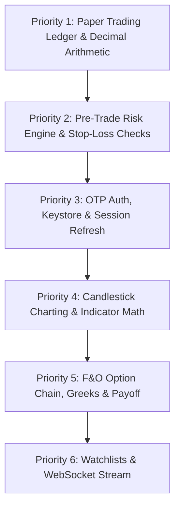

# Testing Strategy & Test Plan: Mobile Application
**Document:** TESTING.md  
**Product:** BOLD Android Trading & Research Platform  
**Target Platform:** Native Android (Kotlin 2.0+, Jetpack Compose, Android 10+ / API 29+)  
**Source of Truth:** [`mobile-application/PRD.md`](file:///d:/trading%20app/mobile-application/PRD.md), [`mobile-application/FEATURES.md`](file:///d:/trading%20app/mobile-application/FEATURES.md), [`mobile-application/API.md`](file:///d:/trading%20app/mobile-application/API.md), and [`mobile-application/AUTH_SECURITY.md`](file:///d:/trading%20app/mobile-application/AUTH_SECURITY.md)  

---

## 1. Testing Tools & Architecture

| Layer | Tool | One-Line Justification |
| :--- | :--- | :--- |
| **Unit Testing** | **JUnit 5 + MockK** | Industry standard for idiomatic Kotlin unit testing with powerful mocking and spying capabilities. |
| **Coroutine & Flow Testing** | **Turbine + Kotlinx Coroutines Test** | Declarative testing library for evaluating Kotlin `StateFlow` and `SharedFlow` emissions in order. |
| **API & Network Mocking** | **OkHttp MockWebServer** | Spins up an in-process HTTP/WebSocket server to test REST responses and WebSocket tick streams. |
| **Android Integration** | **Robolectric** | Executes Android framework and Room database tests inside the local JVM without an emulator. |
| **Compose UI Testing** | **Compose Testing Framework** | Verifies Compose UI trees, 48dp touch targets, semantic nodes, and user interactions. |
| **Code Coverage** | **JaCoCo** | Measures instruction and branch coverage across all Gradle submodules. |

---

## 2. Test Priorities by Layer (Critical Paths First)



1. **Priority 1 (Absolute Financial & Ledger Integrity):**
   * Double-entry paper ledger debit/credit calculations.
   * Zero floating-point arithmetic (`BigDecimal` exact paise verification).
   * Physical isolation guarantee: zero network requests routed to real broker endpoints.
2. **Priority 2 (Pre-Trade Risk Controls):**
   * Per-trade risk budget enforcement ($\le 1\%$ capital).
   * Daily loss cap enforcement ($\le 2\%$ capital).
   * Mandatory stop-loss presence.
3. **Priority 3 (Authentication & Security):**
   * OTP verification and hardware-backed Keystore token storage.
   * Automatic token refresh via OkHttp `Authenticator`.

---

## 3. Test Cases by Feature

### Feature M1: Onboarding, Authentication & Workspace Setup (S01–S03)
| Case ID | Scenario | Input / Action | Expected Result |
| :--- | :--- | :--- | :--- |
| **TC-M1-01** | Valid OTP Submission | Mobile: `+919876543210`, OTP: `248106` | Returns 200 OK; saves tokens to Keystore; navigates to S03. |
| **TC-M1-02** | Invalid OTP Code | Input: `000000` | Gateway returns 400; inputs shake; red border `#FF657A` appears. |
| **TC-M1-03** | OTP Countdown Expiry | Wait 120 seconds | Timer displays `00:00`; "Resend OTP" button activates. |
| **TC-M1-04** | Workspace Capital Init | Select Beginner, ₹10,00,000 capital, 1% risk | Initializes `paper_accounts` balance to ₹10,00,000; lands on S04. |

---

### Feature M2: Home Dashboard & Real-Time Watchlist (S04, S06)
| Case ID | Scenario | Input / Action | Expected Result |
| :--- | :--- | :--- | :--- |
| **TC-M2-01** | Dashboard Index Render | Market status returns NIFTY `+0.68%` | Card renders green badge `#38D996` with `+` sign and `▲` arrow. |
| **TC-M2-02** | Watchlist Scrolling 60 FPS | Rapidly scroll 50-instrument LazyColumn | Frame time remains $< 16ms$; zero layout jittering (`tnum` active). |
| **TC-M2-03** | Real-Time WebSocket Tick | Ingest `{ last_price: 2948.50 }` for RELIANCE | UI price row updates immediately with `@Stable` recomposition skipping. |
| **TC-M2-04** | WebSocket Network Drop | Sever WebSocket connection | Top watermark displays: `● ILLUSTRATIVE / Live quote not connected`. |

---

### Feature M3: Interactive Candlestick Charting & Indicators (S07)
| Case ID | Scenario | Input / Action | Expected Result |
| :--- | :--- | :--- | :--- |
| **TC-M3-01** | 100-Candle OHLC Render | Load 15m candle array | Canvas draws green (`#38D996`) and red (`#FF657A`) bodies and wicks accurately. |
| **TC-M3-02** | Indicator Calculations | Enable EMA 20, VWAP, RSI 14 | Indicator line paths align with mathematical values; RSI sub-chart plots in 0–100 range. |
| **TC-M3-03** | Touch Crosshair Gesture | Touch-drag finger across canvas | Crosshair lines follow touch point; displays precise OHLCV and time pill. |
| **TC-M3-04** | Simulate Trade CTA | Tap "Simulate trade" button at chart base | Launches `OrderTicketBottomSheet` with instrument ID pre-populated. |

---

### Feature M4: Paper Trading Terminal & Risk Engine (S14)
| Case ID | Scenario | Input / Action | Expected Result |
| :--- | :--- | :--- | :--- |
| **TC-M4-01** | Standard Simulated Buy | Buy 10 RELIANCE @ ₹2,948.50, SL: ₹2,910 | Deducts ₹29,490.90 (incl ₹5.90 fee); shows fill receipt; records ledger entry. |
| **TC-M4-02** | Exceed Daily Loss Limit | Order stop-loss risk = ₹25,000 (limit is ₹20,000) | Order ticket rejects order; displays: *"Order exceeds daily 2% risk limit"*. |
| **TC-M4-03** | Insufficient Virtual Cash | Order total debit = ₹9,00,000 (Available: ₹8,00,000) | Order ticket blocks submission; displays: *"Insufficient virtual cash"*. |
| **TC-M4-04** | Order Idempotency | Resend order with identical `X-Idempotency-Key` | Backend returns existing order receipt; zero duplicate cash deduction. |
| **TC-M4-05** | Zero Broker Live Route | Inspect network traffic during execution | Zero HTTP/WebSocket requests transmitted to real broker gateways. |

---

### Feature M5: Virtual Portfolio & Trade Journal (S16)
| Case ID | Scenario | Input / Action | Expected Result |
| :--- | :--- | :--- | :--- |
| **TC-M5-01** | Unrealized P&L Updates | Market tick price moves from ₹2,948.50 to ₹2,960.00 | Open position P&L updates to `+₹115.00` in green `#38D996`. |
| **TC-M5-02** | Save Trade Journal Note | Add 4-star process rating, note, and `#VWAP` tag | Saves to Room SQLite table `offline_trade_journal` with timestamp. |
| **TC-M5-03** | Reset Paper Account | Tap "Reset Account" $\rightarrow$ confirm in dialog | Clears positions; resets cash to ₹10,00,000.00; increments reset count. |

---

### Feature M6: F&O Trade Desk & Option Chain (S11)
| Case ID | Scenario | Input / Action | Expected Result |
| :--- | :--- | :--- | :--- |
| **TC-M6-01** | Option Chain Load | Select NIFTY 50 and nearest expiry | Renders strike table with Calls LTP/OI, Strike, and Puts LTP/OI. |
| **TC-M6-02** | ATM Strike Highlighting | Spot price = 24,836.30 | Strike 24,800 is highlighted with `#1C2734` background and `#F3C969` border. |
| **TC-M6-03** | Greeks Expansion | Tap strike row 24,800 CE | Expands Delta 0.52, Gamma 0.0018, Theta -8.4, Vega 12.6. |
| **TC-M6-04** | Expiry Payoff Canvas | View Long 24,800 CE Payoff | Canvas plots curve showing Breakeven (24,936.80) and Max Risk (₹10,260). |

---

### Feature M7: Market Scanner & Signals Feed (S08, S15)
| Case ID | Scenario | Input / Action | Expected Result |
| :--- | :--- | :--- | :--- |
| **TC-M7-01** | VWAP Reclaim Scan | Tap preset chip "VWAP Reclaim" | Returns 12 matched stocks with criteria checkmarks (`✓ Price > EMA 20`). |
| **TC-M7-02** | Active Signal Display | Open Signals feed tab | Displays RELIANCE Buy signal card with entry zone, stop, and targets. |
| **TC-M7-03** | Signal Invalidation | Price falls below Stop Loss ₹2,910 before entry | Signal badge switches to red `#FF657A` (`INVALIDATED`); trade CTA disables. |

---

## 4. Test Data & Mocking Strategy

### 4.1 In-Memory Room Database
Integration tests execute against an isolated in-memory Room database:
```kotlin
val testDb = Room.inMemoryDatabaseBuilder(
    ApplicationProvider.getApplicationContext(),
    BoldDatabase::class.java
).allowMainThreadQueries().build()
```

### 4.2 Turbine Coroutine Flow Testing
Testing ViewModel `StateFlow` emissions:
```kotlin
@Test
fun `when simulated order confirmed, cash is deducted and position created`() = runTest {
    viewModel.uiState.test {
        val initial = awaitItem()
        assertEquals(BigDecimal("1000000.00"), initial.availableCash)

        viewModel.onEvent(PaperTradeUiEvent.ConfirmBuy(qty = 10, price = BigDecimal("2948.50")))

        val updated = awaitItem()
        assertEquals(BigDecimal("770509.10"), updated.availableCash)
        assertEquals(1, updated.openPositions.size)
    }
}
```

---

## 5. Coverage Targets & Execution Commands

### 5.1 Coverage Targets
* **Financial Calculations & Risk Engine:** **100%** Line & Branch Coverage (Zero tolerance for rounding or fee calculation errors).
* **ViewModels & Repositories:** Minimum **85%** Line Coverage.
* **UI Composables:** Minimum **75%** Node Coverage.

### 5.2 Test Execution Commands

```bash
cd mobile-application

# Run all unit tests across all feature modules
./gradlew test

# Run a specific module unit test (Paper Trading)
./gradlew :feature:papertrading:test --tests "com.bold.trading.papertrading.PaperTerminalViewModelTest"

# Run Android Lint quality checks
./gradlew lintDebug

# Run Compose UI tests on connected emulator
./gradlew connectedAndroidTest

# Generate JaCoCo code coverage report
./gradlew jacocoTestReport
```

---

## 6. Pre-Release Manual QA Checklist

* [ ] **Physical Execution Boundary:** Verify paper trading order ticket never touches real broker gateways.
* [ ] **Decimal Precision:** Verify ledger balance and P&L reconcile to the exact paise (`0.01`) after 20 trades.
* [ ] **Offline Fallback:** Enable Airplane Mode; verify cached watchlists load cleanly with stale data watermark.
* [ ] **Font Scaling (130%):** Set system text size to Largest; verify no text clipping on price rows or buttons.
* [ ] **TalkBack Accessibility:** Enable Android TalkBack; verify screen reader announces price and direction correctly.
* [ ] **Memory Profiler:** Stream market ticks for 15 minutes in Android Studio Profiler; verify zero memory leaks.
